<p align="center">
  
</p>

# TicketGuard · 티켓가드

> 공연 예매 과정에서 어떤 일이 일어났는지 기록하고, 매크로가 의심되는 행동을 살펴볼 수 있는 모의 예매 서비스입니다.

관람객이 좌석을 고르고 예매를 확정하면, TicketGuard는 선택한 좌석과 예매 결과를 기록합니다. 운영자는 이 기록으로 대기열이나 반복 요청처럼 살펴볼 부분을 찾습니다. 자동 시험(QA)은 정상 관람객과 매크로 역할을 맡긴 계정으로 예매를 실행하고, 시스템 판정을 미리 작성한 정답표(Ground Truth)와 비교합니다.

### 처음 읽는다면

[예매자 화면](#13-구현한-기능과-데이터) → [관리자 화면](#29-관리자-대시보드) → [QA 시연](#211-qa-화면에서-시험을-실행하고-결과-읽기) → [실제 시험 결과](#213-확인한-결과)

[예매 기록이 화면에 도착하기까지](#21-전체-아키텍처와-설계-의도) · [용도별 데이터 저장](#25-데이터-저장-구조)

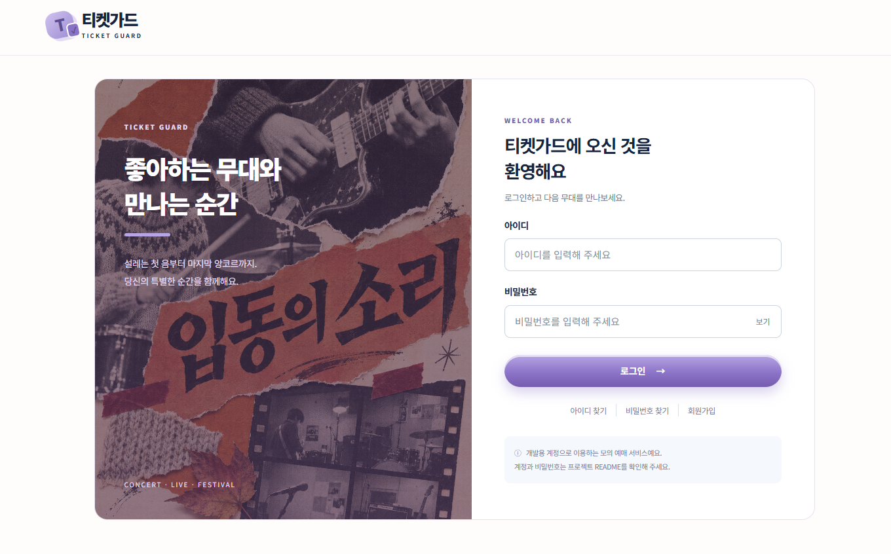

## 1. 서론

### 1.1 프로젝트 시작 배경

공연 예매는 오픈 직후 짧은 시간에 요청이 집중되고, 한정된 좌석을 여러 사용자가 동시에 선택하는 서비스입니다. 자동화 프로그램의 빠른 진입과 반복 요청은 일반 이용자의 예매 기회에 영향을 줍니다.

팀은 **구매 과정에서 발생하는 행동을 연결해 의심 신호를 확인하고, 판단 근거를 기록하는 서비스**를 기획했습니다. 예매 순서와 요청 간격, 대기열 재진입, 보안문자 시도, 좌석 선택, 실제 구매 결과를 함께 살펴보는 방식입니다.

프로젝트의 핵심 과제는 다음과 같습니다.

1. 예매 과정의 행동과 서버 업무 결과를 연결하는 이벤트 수집 구조 구현
2. Kafka·Spark·MongoDB를 연결한 원본 보관·정제·집계 파이프라인 구축
3. 반복 요청과 단계 위반에 대한 서버 정책 및 이상 관측 구현
4. 운영자가 지표와 탐지 근거를 확인하는 관리자 화면 구성
5. 정상·봇 트래픽과 Ground Truth를 이용한 자동 QA 구축

### 1.2 예매 웹과 QA를 함께 만든 이유

예매 단계별 행동, 실패·재시도의 원인, 정상·봇 여부를 함께 확인할 데이터를 확보하기 위해 예매 웹과 QA를 직접 구현했습니다.

예매 웹은 로그인, 공연 조회, 대기열, 보안문자, 좌석 선택, 예매 확정의 흐름을 제공합니다. QA는 시험 계정으로 이 흐름을 수행하며 정상 사용자와 여러 유형의 매크로 행동을 재현합니다.

Ground Truth와 봇 설정은 QA 영역에 보관하고, 시스템에는 예매 요청과 관측 이벤트를 전달합니다. 시스템이 처리한 결과를 QA가 Ground Truth와 대조하는 독립 검증 구조를 구성했습니다.

### 1.3 구현한 기능과 데이터

#### 예매자 화면 — 공연을 찾고 회차 고르기

**1. 공연 찾기**

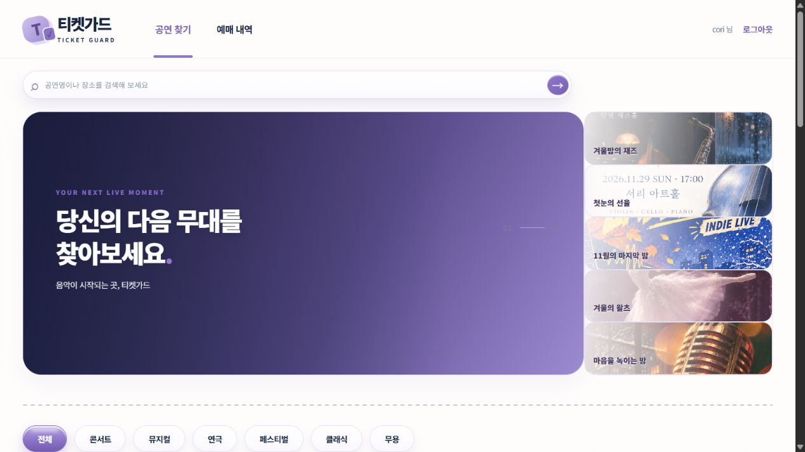

첫 화면에서 추천 공연을 둘러보거나 공연명과 장소로 검색할 수 있습니다. 콘서트, 뮤지컬, 연극 같은 장르를 선택하면 아래 공연 목록이 해당 장르로 좁혀집니다.

**2. 공연 상세에서 예매할 날짜와 시간 고르기**

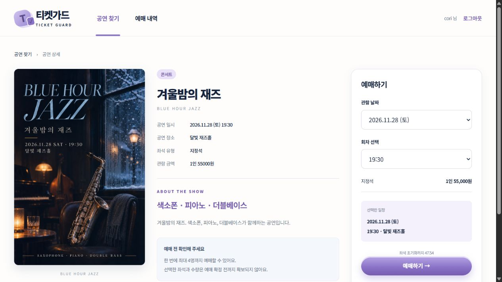

공연을 고르면 상세 화면에서 장소, 가격, 좌석 유형을 확인할 수 있습니다. 오른쪽에서 관람 날짜와 시작 시간을 고른 뒤 **예매하기**를 누르면 대기열과 보안 확인을 거쳐 좌석·인원 선택으로 이어집니다.

<details>
<summary>구현 기능과 사용하는 데이터 전체 보기</summary>

| 구현 영역 | 작업 내용 | 다루는 데이터 |
|---|---|---|
| 예매 서비스 | 회원가입·로그인, 공연 탐색, 대기열, 보안문자, 좌석·인원 선택, 예매 확정·내역 | 계정, 예매 시도, 재고, 구매 기록, 정책 상태 |
| 관측·전달 | 브라우저 행동과 서버 업무·HTTP 관측, 민감값 정제, Kafka 발행 | 화면 이동, 클릭·선택, 요청·응답, 성공·실패, 시각 |
| 원본 보관 | 원문과 전송 위치 보관, 종류별 라우팅, 저장 확인 후 커밋 | 원문 바이트, 출처, 토픽, 파티션, 오프셋 |
| 스트리밍 분석 | 정제·격리, 사용자 흐름, 요청 상태, 이상 관측·사전 모니터링 | 최소 관측값, 지표, 규칙·버전, 근거, 처리 상태 |
| 관리자 화면 | 사용자 흐름·네트워크 상태·이상탐지, 단계별 탐지·조치 조회 | 공개 결과, 기준 시각, 대상·근거·상태 |
| 자동화 QA | 트래픽 생성, Ground Truth 대조, 전달·적재·지연·회귀·복구 테스트 | Run, 테스트 스위트, 봇 버전, 측정값·결과 |
| 인프라·배포 | EC2 스테이징 운영, Terraform import, SSM 기반 DB 접근 | AWS 리소스 32개, 보안 그룹, IAM 정책 |

</details>

### 1.4 팀원 소개

<table width="100%">
  <tr>
    <th align="center" width="220">팀원</th>
    <th align="left" width="780">담당 역할 및 주요 작업</th>
  </tr>
  <tr>
    <td align="center" width="220">
      <a href="https://github.com/callijee22-ship-it">
        <br />
        <strong>류지예</strong>
      </a><br />
      <sub>팀장</sub>
    </td>
    <td width="780">
      <br />
      <strong>Frontend · UI · 문서화</strong><br /><br />
      예매·관리자 화면 및 공통 테마 구성<br />
      웹 기능 개선, README·구조도·발표자료 작성
      <br /><br />
    </td>
  </tr>
  <tr>
    <td align="center" width="220">
      <a href="https://github.com/seoloo">
        <br />
        <strong>설호현</strong>
      </a>
    </td>
    <td width="780">
      <br />
      <strong>QA · 매크로 봇 · 배포</strong><br /><br />
      QA 대시보드·자동화 시험·매크로 봇 구현<br />
      QA DB 및 AWS 실행 환경 구성
      <br /><br />
    </td>
  </tr>
  <tr>
    <td align="center" width="220">
      <a href="https://github.com/SeokHwanHong">
        <br />
        <strong>홍석환</strong>
      </a>
    </td>
    <td width="780">
      <br />
      <strong>DB · 데이터 파이프라인 · 이상탐지</strong><br /><br />
      MongoDB·Kafka·Spark 연결 및 데이터 적재<br />
      이상탐지 로직·관리자 지표 구현
      <br /><br />
    </td>
  </tr>
</table>

프로젝트 흐름과 웹페이지 기획·구성은 팀이 함께 논의하고, 각 담당 영역을 연결해 예매·수집·분석·조회·검증 흐름을 구성했습니다.

## 2. 과정

### 2.1 전체 아키텍처와 설계 의도

예를 들어 관람객이 좌석을 고르면 예매 웹은 좌석을 골랐다는 기록을 남깁니다. Kafka는 이 기록을 원본 보관과 분석을 맡은 작업에 전달합니다. 원본은 MongoDB에 보관하고, Spark는 기록의 형식을 확인한 뒤 예매 단계별로 집계합니다. 관리자 화면은 검증을 마치고 조회할 수 있게 된 집계를 보여줍니다.

**업무 처리, 원본 보관, 분석, 결과 조회, QA 채점을 역할별로 분리하고 같은 이벤트의 근거로 연결**했습니다.


예매 웹은 업무 요청을 처리하며 Kafka의 공통 토픽 `ticketguard.events.v1`로 이벤트를 발행합니다. Kafka 이후에는 Raw Consumer와 Spark 작업이 병렬로 이벤트를 소비합니다.

| 구성요소 | 담당 역할 |
|---|---|
| 예매 웹 | 업무 처리, 서버 정책 적용, 브라우저·서버 이벤트 생성 |
| Kafka | 공통 이벤트 전달과 소비 경로 분리 |
| Raw Consumer | 원문·전송 위치 보관, 종류별 컬렉션 라우팅 |
| Spark ingest | 정제·격리, 이벤트 집계, 이상 관측 저장 |
| Spark flow | 원본 대조, 사용자 흐름 계산, 사전 모니터링 |
| Spark network | 원본 대조, 서버 요청 상태 집계 |
| 관리자 대시보드 | 공개된 지표와 탐지·조치 근거 조회 |
| QA | 트래픽 생성, 결과 수집(읽기 전용), Ground Truth 대조·채점 |
| AWS EC2 | 전체 컨테이너 실행, Nginx 게이트웨이만 외부 공개 |

`flow`와 `network`는 자신이 소비한 Kafka 입력을 저장된 원본과 대조합니다. Kafka 전달, 원본 저장, 분석 처리, 결과 공개, 브라우저 표시를 각각의 완료 단계로 관리해 이벤트의 처리 위치를 확인하도록 구성했습니다.

### 2.2 기술 스택

예매 웹은 Django로 구성했고, Kafka가 기록을 전달하면 Spark가 분석하고 MongoDB가 데이터를 보관합니다.

<details>
<summary>기술 스택과 구성 요소별 역할</summary>

| 영역 | 기술 |
|---|---|
| Frontend |      |
| Backend |     |
| Database |   |
| Messaging |   |
| Data Processing |    |
| Infrastructure |      |
| Testing & QA |     |
| CI |  |

Frontend는 HTML·CSS·JavaScript와 서버 템플릿으로 예매·관리자·QA 화면을 구성합니다. Backend는 Django의 예매 업무·인증과 FastAPI의 관리자·QA 앱으로 역할을 나눕니다. Kafka는 이벤트 전달을, Spark는 정제·집계·이상 관측을 담당하며, MongoDB는 데이터를 용도별로 보관합니다. 스테이징 서버는 AWS EC2에서 운영하며, AWS 리소스 구성은 Terraform 코드로 관리합니다([`infra/terraform`](infra/terraform/README.md)).

</details>

### 2.3 데이터 수집과 Kafka 전달

브라우저에서는 화면 진입·이탈, 검색, 공연·회차·좌석 선택과 관측 가능한 요청·응답·성능·오류를 수집합니다. 서버에서는 로그인·예매 업무 결과와 HTTP 요청 처리 관측을 기록합니다.

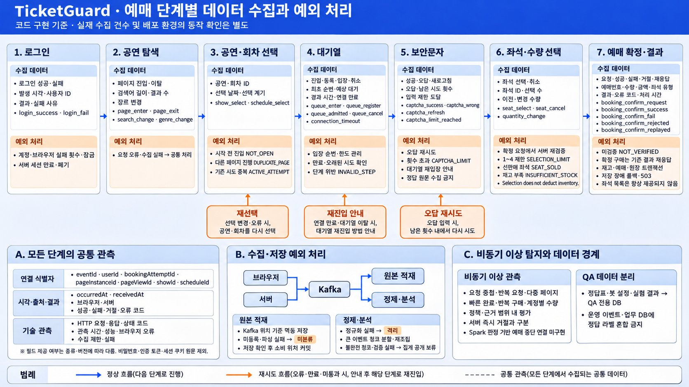

그림의 위쪽은 **관람객이 예매하는 순서**입니다. 왼쪽에서 오른쪽으로 따라가면 단계마다 어떤 행동을 기록하고, 실패나 만료가 발생하면 어떻게 처리하는지 볼 수 있습니다. 예를 들어 대기열에서는 진입·입장·취소를 기록하고, 연결이 만료되면 재진입을 안내합니다. 보안문자에서는 성공·오답·재시도를 기록하며, 입력한 답의 원문은 수집하지 않습니다.

그림의 아래쪽은 **수집한 데이터가 이동하는 경로**입니다. 브라우저와 서버에서 발생한 이벤트는 Kafka에 전달된 뒤 원본 보관과 정제·분석에 사용됩니다. QA의 정답표와 봇 설정은 QA 전용 DB에서 관리합니다. 이 그림은 코드에 구현된 흐름을 기준으로 정리했으며, 실제 시험에서 확인한 수치는 [2.13 확인한 결과](#213-확인한-결과)에 정리했습니다.

#### 예매 중 문제가 생기면 어떻게 처리하나요?

공연을 예매하다 보면 대기열 연결이 끊기거나, 보안문자를 틀리거나, 방금 고른 좌석을 다른 사람이 먼저 구매할 수 있습니다. **예외 처리**는 이런 상황에서 시스템이 무엇을 확인하고, 관람객에게 어떤 다음 행동을 안내할지 정해 둔 방식입니다.

| 이런 일이 생기면 | TicketGuard는 이렇게 처리합니다 |
|---|---|
| **기다리던 중 대기열 연결이 끊겼어요.** | 대기열 연결이 만료됐는지 확인하고, 만료된 경우 다시 입장하는 방법을 안내합니다. |
| **보안문자를 잘못 입력했어요.** | 남은 시도 횟수 안에서 다시 입력할 수 있습니다. 허용 횟수를 넘기면 대기열에 다시 들어가도록 안내합니다. |
| **선택한 좌석을 다른 사람이 먼저 구매했어요.** | 좌석을 고르는 단계에서는 재고가 줄지 않습니다. 예매를 확정하는 순간 서버가 해당 좌석이 아직 남아 있는지 다시 확인하고, 이미 판매됐다면 확정 요청을 거절합니다. |
| **예매가 됐는지 몰라 확정 버튼을 다시 눌렀어요.** | 같은 예매 시도가 이미 확정됐다면 기존 결과를 다시 보여줍니다. 같은 요청이 반복돼도 예매는 한 번만 확정됩니다. |

시스템은 각 단계에서 성공·실패 여부와 원인을 기록합니다. 예를 들어 대기열 연결 만료와 좌석 선판매는 둘 다 예매 진행을 멈추게 하지만, 기록을 보면 **어느 단계에서 어떤 이유로 멈췄는지** 구분할 수 있습니다. 운영자는 이 기록으로 문제를 살펴보고, QA는 같은 상황을 다시 만들어 시스템이 기대한 대로 처리하는지 확인합니다.

한 번의 예매에서도 화면 클릭, 서버 응답, 예매 결과는 각각 기록됩니다. 아래 표는 이 기록을 같은 예매 시도에 연결하고, 구간별로 걸린 시간을 계산하는 데 쓰는 정보입니다.

<details>
<summary>예매 기록을 연결하는 ID와 전송 방식</summary>

| 식별·시간 정보 | 사용 목적 |
|---|---|
| `eventId` | 동일 이벤트의 재전달과 중복 확인 |
| `bookingAttemptId` | 한 번의 예매 시도에 속한 업무·판정 연결 |
| `pageInstanceId` | 브라우저 페이지 관측과 사용자 흐름 연결 |
| `observationRequestId` | 서버 수신 요청과 관련 업무 사건 연결 |
| `userId`, `showId`, `scheduleId` | 계정·공연·회차별 분석 범위 구분 |
| `occurredAt`, `receivedAt`, `normalizedAt` | 발생·수신·정제 시점 및 구간별 지연 계산 |
| Kafka 출처·토픽·파티션·오프셋 | 원문 위치와 분석 입력의 대응 확인 |

민감값은 관측 단계에서 정제하고, 브라우저와 서버의 출처를 구분해 기록합니다. 큰 관측 이벤트는 청크로 나누어 전달하며 분석 경로에서 재조립 상태를 관리합니다.

웹의 정책·구매·계정 관련 이벤트는 MongoDB 트랜잭션과 Outbox를 사용해 업무 상태와 연결합니다. 대기 이벤트는 전송 성공까지 보관하고 Kafka 장애 이후 재전송하도록 구성했습니다.

</details>

### 2.4 원본 보관, 정제와 결과 공개

받은 기록은 원본으로 보관하고, 분석에 쓸 수 있도록 형식을 확인합니다. 형식이 맞지 않는 기록은 따로 보관합니다. 분석 결과는 필요한 자료가 갖춰졌는지 확인한 뒤 관리자 화면에 공개합니다.

<details>
<summary>원본 저장·분석·결과 공개의 세부 규칙</summary>

#### 원본 보관

Raw Consumer는 원문 바이트와 Kafka 전송 위치를 보존합니다. 이벤트 종류에 따라 `behavior_events`, `booking_events`, `auth_events`, `http_events`, `raw_chunks`, `unclassified_events` 등의 컬렉션으로 분류합니다.

저장 성공을 확인한 뒤 오프셋을 커밋하고, 부분 저장 실패 후 재수신한 입력은 동일 전송 위치를 기준으로 멱등 저장합니다.

#### 정제·격리와 분석

| 처리 경로 | 처리 내용 | 저장 결과 |
|---|---|---|
| `ingest` | 이벤트 해석·정규화, 정상·격리 분리, 이상 관측·집계 | `clean_events`, `quarantine_events`, `event_metrics`, `anomaly_*` |
| `flow` | 원본 대조, 청크 재조립, 단계·활동·예매 결과 계산 | `flow_versions`, `flow_series`, `flow_public`, `early_*` |
| `network` | 원본 대조, 요청 ID별 중복 제거, 서버 요청 상태 집계 | `network_versions`, `network_series`, `network_public`, 조회 뷰 |

형식 검증에 실패한 자료는 격리합니다. 정제된 이벤트에서 행동상 이상 신호가 발견되면 해당 이벤트에 별도의 이상 근거를 연결합니다. 형식 검증과 행동 분석을 나누어 관리하는 구조입니다.

#### 결과 공개

사용자 흐름과 네트워크 결과는 버전별 결과를 저장한 뒤 공개 포인터로 조회할 버전을 지정합니다. 사전 모니터링도 불변 버전과 공개 포인터·health 상태를 사용합니다. 이상 관측은 공개 문서와 health의 게시 시각·규칙 버전을 대조합니다.

부분 쓰기나 버전 불일치가 발생하면 새 결과의 공개를 보류하고, 조회 측에서도 공개 상태와 일관성을 확인합니다. 각 결과 계열의 저장·조회 계약에 맞춰 공개 절차를 구현했습니다.

</details>

### 2.5 데이터 저장 구조

예매 내역과 좌석 재고는 예매 서비스가 사용합니다. 원본 기록은 나중에 문제가 생겼을 때 어떤 일이 있었는지 확인하는 데 쓰고, 분석 결과는 관리자가 서비스 상태를 보는 데 사용합니다. 정상 관람객과 봇을 구분하는 시험 정답표는 QA 전용 DB에 따로 보관합니다.

<details>
<summary>DB별 이름·권한·컬렉션 관계</summary>

| 논리 DB | 역할 | 대표 데이터 |
|---|---|---|
| `ticketguard_web_state` | 예매 업무와 서버 정책 상태 | 계정·가입 기록, 예매 시도·내역, 재고, 구매 원장, 로그인 세션, Outbox |
| `ticketguard_pipeline_state` | 분석 작업의 처리·복구 상태 | 청크, 재조립 결과, 최소 관측, 배치·복구 위치·guard |
| `ticketguard_raw` | 원본 보관 | 종류별 원문, Kafka 출처·전송 위치 |
| `ticketguard` | 정제·격리·이상 관측·요청 분석 | 정제·격리 이벤트, 이상 근거, 네트워크 결과 |
| `ticketguard_flow` | 사용자 흐름·사전 모니터링 | 흐름·탐지·조치 근거·공개 버전 |
| `ticketguard_qa` | 독립 테스트와 채점 | Run, Ground Truth, 페르소나·봇 버전, 내보내기 이력 |
| `ticketguard_qa_archive` | 선택적 종료 시험 전달 | 승인된 종료 시험과 선택한 전달 자료 |

기본 논리 DB 6개와 선택적 전달 DB 1개를 구성하고, 역할별 연결과 권한을 분리했습니다. 실제 DB 이름과 접속 대상은 환경 설정으로 관리합니다.

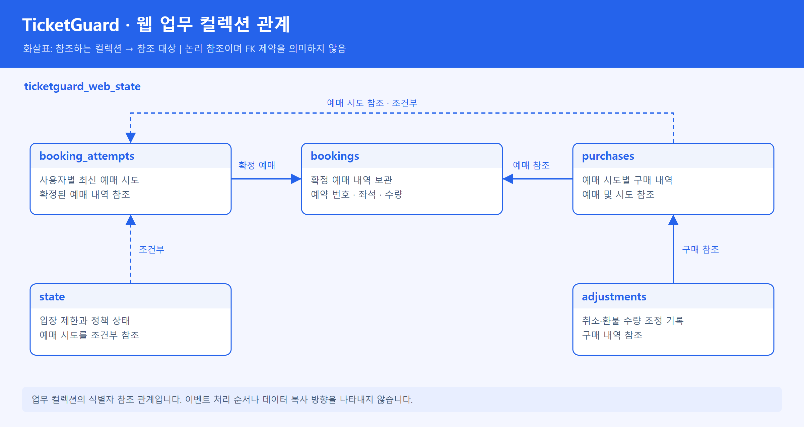

위 그림은 주요 예매·구매·정책 컬렉션의 논리 참조 관계입니다. 계정·가입 기록은 `accounts`·`account_events`, 재고는 `booking_inventory`, 로그인 세션은 `web_sessions`, 전송 대기 이벤트는 `outbox`에서 관리합니다. 구매 원장과 취소·환불 수량 조정을 연결하는 저장 계약도 구현했습니다.

</details>

### 2.6 지연 이벤트와 장애 복구

원본 적재 지연, 이벤트 도착 순서 변화, 일부 문서 저장 후 작업 중단에 대응하도록 재시도·재계산·멱등 저장·공개 상태 관리를 구현했습니다.

<details>
<summary>지연·장애 상황별 대응 방식</summary>

| 처리 상황 | 구현한 대응 |
|---|---|
| 원본 적재 지연 | 기본 최대 10초 동안 0.25초 간격으로 원본 대조 재시도, 대조 결과에 따른 공개 상태 관리 |
| 지연·역순 이벤트 | 발생 시각과 식별자를 기준으로 보존 범위 안에서 재계산 |
| 네트워크 구간의 지연 도착 | 완료된 5분 구간 12개에 속하는 자료를 다음 게시 버전에 반영 |
| 뒤늦게 확인된 좌석 경쟁·재고 부족 | 추가 근거에 따라 기존 이상 신호를 철회 상태로 정정하고 이력 유지 |
| 청크 재조립 대기 | 조각과 재조립 상태 보관, 완료 여부에 따른 공개 제어 |
| 원본 부분 저장 후 실패 | 저장 확인 후 오프셋 커밋, 재수신 시 멱등 저장 |
| Spark 배치·결과 저장 실패 | 체크포인트와 복구 상태를 이용한 재처리, 미완료 결과의 공개 보류 |
| Kafka 전송 실패 | 웹 Outbox에 전송 대기 이벤트 보관 후 재전송 |
| 관측 공백 | 시계열에 미관측 상태와 `null` 기록 |

Spark 체크포인트는 소비 진행 위치를, 전용 MongoDB 상태는 파생 관측·배치·청크 등 복구 정보를 관리합니다. 재시작 시 기존 체크포인트와 저장된 상태를 연결해 처리를 이어가도록 구성했습니다.

이상 관측과 사전 모니터링은 최근 2시간의 판정 갱신 범위와 추가 300초의 비교 유예를 사용하며, 화면에는 최근 1시간의 결과를 공개합니다.

</details>

### 2.7 설정 개선과 튜닝 과정

처리 주기, 배치 입력량, DB 쓰기 묶음, 원본 대기와 상태 크기를 조정할 지점을 분리했습니다.

| 항목 | 코드 기준 기본값·구성 | 적용 목적 |
|---|---|---|
| ingest 처리 주기 | `SPARK_TRIGGER_SECONDS=1`초 | 정제·적재 마이크로배치 주기 |
| flow 처리 주기 | `FLOW_TRIGGER_SECONDS=1`초 | 사용자 흐름 갱신 주기 |
| 배치 입력량 | `SPARK_MAX_OFFSETS_PER_TRIGGER=1000` | 배치당 Kafka 입력량 제한 |
| ingest DB 쓰기 묶음 | `SPARK_MONGO_BULK_SIZE=200` | 문서별 호출을 묶음 쓰기로 처리 |
| ingest DB 쓰기 시도 | `SPARK_MONGO_WRITE_ATTEMPTS=3` | 재시도 가능한 쓰기 실패에 대응 |
| ingest 셔플 파티션 | `spark.sql.shuffle.partitions=2` | 현재 실행 구성의 파티션 설정 |
| flow 원본 대기 | 기본 최대 10초 | 병렬 소비에 따른 원본 적재 지연 허용 |
| flow 시계열 | 업무 집계 최근 1시간, 공개 그래프 최근 10초·1초 격자 | 조회 기간과 시계열 크기의 명시적 제한 |
| 관리자 재조회 | 30초 | 공개된 결과의 브라우저 표시 갱신 |

ingest·flow·network는 1초 처리 주기와 배치 입력 상한 1,000개를 사용합니다. flow·network 그래프는 DB의 실제 1초 시계열 중 최근 10초를 표시하고 매초 조회합니다. 긴 이상탐지 추이는 30초마다 갱신합니다. 처리·집계·조회 주기를 종단 지연으로 해석하지 않습니다.

| 개선 대상 | 작업 내용 | 확인한 결과 |
|---|---|---|
| 원본 적재 시작 지연 | 약 1초였던 원본 대기를 기본 최대 10초의 설정과 재시도로 구성 | 보완 후 격리 통합 시험의 원본 대조·공개 경로 확인 |
| 토픽 준비 순서 | 선행 토픽 준비 서비스로 소비 시작 순서 정리 | 최종 격리 프로젝트에서 전체 처리 경로 확인 |
| 시계열 중복 저장 | 요약과 시계열을 분리하고 버전·포인터로 공개 | 요약 문서와 시계열의 저장 구조 분리 |
| 부분 저장과 공개 | 저장 완료 후 공개하고 health·버전·시각 대조 | 미완료 상태와 이전 공개 결과를 구분하는 조회 경로 구현 |
| 누적 상태·문서 크기 | 관측 수·차원 수·문서 크기의 안전 상한 검사 | 상한 초과 시 작업 실패와 공개 보류 처리 |

이 과정에서 원본 적재와 분석의 시작 순서를 맞추고, 시계열 저장 구조와 공개 절차를 정리했습니다. 처리 지연 측정 결과는 2.13절에 시험 구성별로 정리했습니다.

### 2.8 이상탐지와 서버 정책

| 구분 | 처리 위치·시점 | 담당 역할 |
|---|---|---|
| 서버 즉시 정책 | 웹 요청 처리 시점 | 반복 위반과 구매 한도 판단, 요청 제한 |
| 사전 관찰 | Spark flow의 사전 모니터링 | 요청·탐지·서버 조치 집계, 관찰 신호 게시 |
| 이상 관측·사후 분석 | Spark ingest | 서버 요청과 구매 결과의 시간·횟수·수량 분석 |

#### 서버 즉시 정책

웹 서버가 요청 처리 시점에 다음 기준으로 판단하며, 적용한 정책과 버전을 이벤트에 함께 기록합니다.

| 정책 | 적용 기준 | 적용 단위 |
|---|---|---|
| 반복 로그인 실패 | 계정 누적 5회, 성공 시 초기화 | 계정과 실제·시뮬레이션 구분 |
| 오픈 전 반복 요청 | 직전 2초 내 `NOT_OPEN` 시작 요청 10회 | 계정·공연·회차·자료 구분 |
| 반복 재입장 | 직전 2초 내 새로운 예매 시도 10개 | 계정·공연·회차·자료 구분 |
| 반복된 잘못된 선택 | 직전 5초 내 지정된 선택 오류 10회 | 예매 시도와 계정·공연·회차 |
| 구매 한도 초과 시도 | 유효 구매량과 요청량의 합이 4매 초과 | 계정·공연·회차·자료 구분 |

각 제한은 300초로 관리하며 적용 시점의 만료 시각을 유지합니다. 선택 오류는 지정된 조건으로 집계하고, 좌석 경쟁·재고 부족·통신·서버 오류는 사유별로 구분합니다. 보안문자·단계·페이지 소유권 검사도 함께 적용합니다.

#### Spark 이상 관측

서버 요청 처리 구간 중첩, 동일 시도의 빠른 재요청, 다중 페이지 구매 요청, 빠른 예매 완료, 반복 구매, 관측 시간창 내 구매 수량을 확인합니다. 규칙별 활성 여부와 기준값은 설정으로 관리합니다.

사전 모니터링은 **확정 요청 3초 내 10회**를 관찰 전용 규칙으로 집계합니다. 웹 서버는 즉시 정책에 따른 요청 제한을 담당하고, Spark는 관찰 신호와 서버의 실제 조치를 각각 게시합니다.

탐지 결과에는 규칙·버전·기준값·관측값·관련 이벤트를 남깁니다. 평가·지연 대기·철회 등 상태와 고유 시도·신호 수를 구분해 관리합니다. 이 근거를 QA의 Ground Truth와 연결해 채점하는 구조를 구성했습니다.

### 2.9 관리자 대시보드

관리자로 로그인한 뒤 콘솔에서 **DB 대시보드**를 선택하면 세 가지 화면을 볼 수 있습니다. 아래 캡처는 배포 화면의 구성 예시입니다. 캡처 당시에는 `공개 결과 없음` 상태여서 주요 수치가 `—`로 표시됐습니다.

**1. 사용자 흐름 — 관람객이 예매의 어느 단계에 있는지 보기**

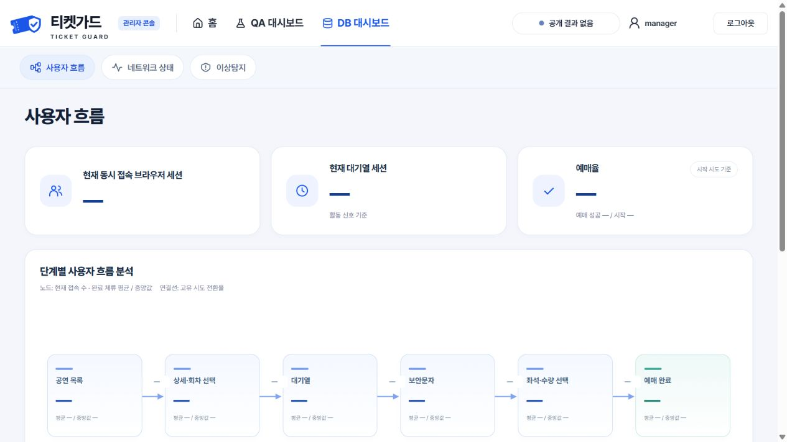

위쪽 카드에서는 현재 접속과 대기열 규모, 예매를 시작한 시도 중 완료된 비율을 확인합니다. 아래 그림은 공연 목록부터 예매 완료까지의 순서를 보여줍니다. 집계가 표시되면 어느 단계에 사용자가 머물고 다음 단계로 얼마나 이동했는지 살펴볼 수 있습니다.

예를 들어 대기열에 머무는 시간이 길어지고 보안문자 단계로 넘어가는 비율도 낮아지면, 운영자는 대기열 입장이나 다음 화면으로 넘어가는 과정에 문제가 있는지 확인할 수 있습니다.

**2. 네트워크 상태 — 웹 요청이 잘 처리되는지 보기**

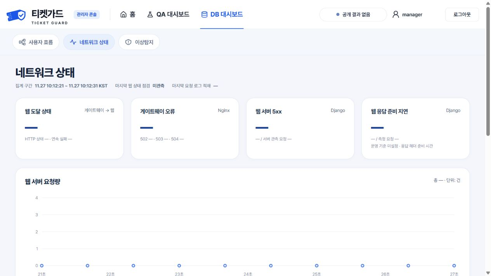

웹 서버에 요청이 도달하는지, 요청을 전달하는 구간과 웹 서버 중 어디에서 오류가 늘었는지 확인합니다. 아래 그래프에서는 시간에 따라 요청이 얼마나 들어왔는지 볼 수 있습니다.

**3. 이상탐지 — 평소와 다른 요청 패턴 살펴보기**

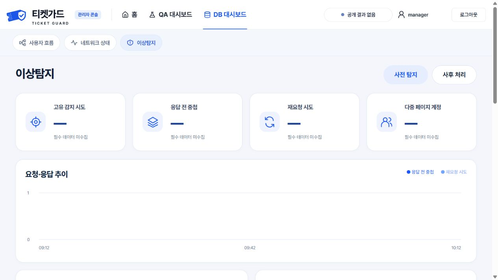

이전 요청의 응답이 오기 전에 또 요청했거나, 같은 계정이 여러 페이지에서 활동한 경우처럼 검토할 만한 신호를 살펴봅니다. 화면 아래의 감지 목록과 단계별 상세에서는 어느 예매 단계에서 어떤 신호가 관측됐는지 확인할 수 있습니다.

<details>
<summary>관리자 접근 경로와 지표 갱신 방식</summary>

팀 게이트웨이에서 예매 웹의 관리자 세션을 확인한 뒤 `/admin/`으로 연결합니다.

| 관점 | 화면 내용 |
|---|---|
| 사용자 흐름 `/admin/#flow` | 단계별 활동 접속, 체류·전환, 예매 시작·성공, 시계열 |
| 네트워크 상태 `/admin/#network` | 서버 요청·오류·응답 관련 수치와 구간별 추이 |
| 이상탐지 `/admin/#anomaly` | 사전 탐지·사후 처리, 감지 목록, 계정 타임라인, 구매 사례 |
| 단계별 탐지 | 로그인, 예매 시작·대기열, 좌석·인원 선택, 예매 확정의 탐지·조치 상세 |

지표는 `/admin/metrics`를 1초마다 재조회하며 긴 이상탐지 추이는 30초마다 갱신합니다. 재조회 실패 시 이전 화면과 실패 상태를 유지하며 다음 주기에 재시도합니다. DB 조회 실패, 미공개, 오래된 자료, 구버전 집계 미반영을 샘플 값이나 정상 0건으로 대체하지 않습니다.

활동 접속은 최근 30초 활동을 기준으로 계산합니다. 요청 수, 업무 사건 수, 고유 시도 수, 계정 수, 탐지 수, 조치 수는 각각의 단위로 표시합니다.

</details>

### 2.10 QA가 예매 서비스를 검증하는 방법

공연 예매가 열리면 좌석을 고르는 관람객과 자동으로 예매를 시도하는 매크로가 함께 들어올 수 있습니다. TicketGuard의 QA는 두 종류의 행동을 시험 계정으로 재현해 **정상 관람객이 예매를 진행할 수 있는지, 시스템이 매크로를 찾아내는지, 예매 과정의 기록이 빠짐없이 저장되는지** 확인합니다.


1. **시험 참가자를 정합니다.** 정상 관람객 역할과 매크로 역할을 나누고, 각 예매 세션이 맡은 역할을 QA 정답표(Ground Truth)에 기록합니다.
2. **예매를 시켜 봅니다.** 시험 계정으로 로그인한 뒤 공연 선택, 대기열, 보안문자, 좌석 선택, 예매 확정까지 진행합니다. 참가자는 각자 맡은 역할에 따라 다르게 행동합니다.
3. **결과를 확인합니다.** 예매가 어떻게 끝났는지, 기록이 Kafka에 도착해 저장됐는지, 시스템이 누구를 봇으로 판정했는지 확인합니다.
4. **정답표와 비교합니다.** QA는 같은 예매 건을 가리키는 ID로 시스템 판정과 정답표를 연결해, 봇을 놓치거나 정상 관람객을 봇으로 잘못 판단한 사례를 찾습니다.

#### 시험 참가자는 어떤 행동을 하나요?

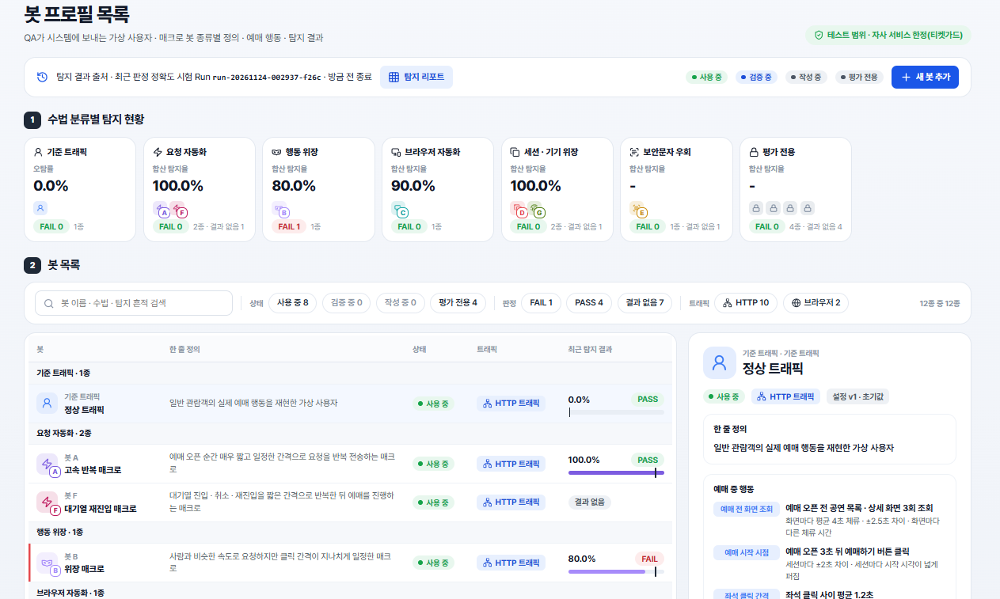

**봇 프로필**은 시험 참가자가 어떤 방식으로 예매할지를 정한 설정입니다. 목록에서 프로필을 고르면 오른쪽에서 어떤 행동을 하는지 볼 수 있고, 화면 위쪽에서는 각 유형의 최근 탐지 결과를 확인할 수 있습니다.

| 참가자 유형 | 시험에서 재현하는 행동 |
|---|---|
| 정상 관람객 | 공연을 둘러보고 각자 다른 시점에 예매를 시작합니다. |
| 매크로 7종 | 요청을 빠르게 반복하거나, 버튼을 자동으로 누르거나, 대기열에 여러 번 들어가는 등 서로 다른 행동을 재현합니다. |
| 평가 전용 4종 | 탐지 규칙을 만들 때 사용하지 않은 행동 조합으로도 시스템이 봇을 찾아내는지 살펴봅니다. |

화면에서 **탐지율**은 시험에 참여한 봇 중 시스템이 찾아낸 비율입니다. **오탐률**은 정상 관람객 중 봇으로 잘못 판정된 비율입니다. `결과 없음`은 해당 프로필에서 아직 표시할 측정값이 없다는 뜻입니다.

<details>
<summary>QA 정답표와 시험 기록은 어디에 저장하나요?</summary>

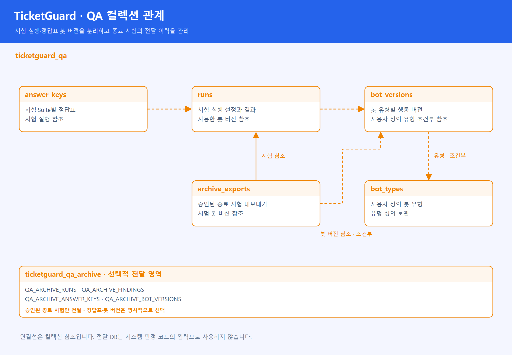

QA 정답표에는 각 예매 세션이 맡은 역할이 들어 있습니다. 정답표와 봇 설정, 진행 중인 시험 기록은 QA 전용 DB에 보관합니다. 예매 시스템은 예매 요청과 관측 기록을 바탕으로 판정합니다. QA는 읽기 전용 계정으로 그 결과를 조회해 정답표와 비교합니다. 승인된 종료 시험은 별도 영역에서 관리하며, 전달할 정답표와 봇 버전을 선택할 수 있습니다.

</details>

<details>
<summary>테스트 데이터와 봇 유형 자세히 보기</summary>

| 구분 | 내용 |
|---|---|
| 테스트 환경 | Live(예매 웹·Kafka·Spark·MongoDB 실제 연결), Mock(절차·채점 검증용 모의 환경) |
| 테스트 범위 | 예매 기능, 이벤트 전달·적재, 탐지 정확도, 데이터 신선도, 동시성·부하·복구 |
| 테스트 데이터 | 공연 `blue-hour` 1회차, 실행 전 시험 데이터 초기화, 시험 계정 순환 배정 |
| 부하 조건 | 가상 사용자 수(VU), 부하 패턴(Spike·분할 유입), 페르소나별 트래픽 비율 |
| 데이터 격리 | Ground Truth·봇 설정은 QA DB에만 보관, 시스템에는 예매 요청과 관측 이벤트만 전달 |

페르소나는 정상 1종, 매크로 7종, 미학습 패턴(Unseen) 4종입니다. HTTP 봇은 httpx로, 봇 C·D는 Playwright 브라우저로 예매 웹을 조작합니다. 사용자 정의 페르소나와 행동 버전도 추가로 관리할 수 있습니다.

| 페르소나 | 재현 행동 | 탐지 신호 | 평가 그룹 |
|---|---|---|---|
| 정상 | 시작 시각과 클릭 간격이 분산된 예매 | 정상 흐름 기준 | 오탐률(FPR) |
| 봇 A | 고속·정주기 요청 반복 | 빠른 반복, 화면 조회 생략 | 매크로 |
| 봇 B | 사람 수준 속도와 일정한 간격 | 일정한 행동 패턴 | 매크로 |
| 봇 C | 브라우저 버튼 자동 클릭 | 화면 이벤트가 있는 자동화 | 브라우저 자동화 |
| 봇 D | 동일 기기의 여러 계정·창 동시 진입 | 동시 세션·페이지 | 매크로 |
| 봇 E | 보안문자 오답·새로 받기 반복 | 반복 시도와 제한 | 매크로 |
| 봇 F | 대기열 진입·취소·재진입 반복 | 시도 변화·재진입 | 매크로 |
| 봇 G | 세션별 기기·브라우저 정보 변경 | 정보 변경 | 매크로 |
| 미학습 4종 | 탐지 규칙 설계에 쓰지 않은 행동 조합 | 신규 패턴 대응 | 결과 공개(합격 기준 제외) |

보안문자 시험은 시험용 조건에서 반복 시도와 제한 동작을 확인하도록 구성했습니다.

</details>

### 2.11 QA 화면에서 시험을 실행하고 결과 읽기

QA 화면은 **설정 → 진행 확인 → 결과 확인** 순서로 사용합니다. 화면의 `Run`은 한 번의 시험 실행을 뜻하고, `Suite`는 그 안에서 선택할 수 있는 개별 검사입니다.

#### 1. Run 설정 — 누가 참여하고 무엇을 검사할지 정합니다


위 화면은 **가상 사용자 200명이 한 번에 예매에 진입**하도록 구성한 예입니다. 정상 관람객 역할은 80%, 매크로 역할은 20%로 설정했습니다. 왼쪽에서 참가 인원과 검사 항목을 고르고, 오른쪽에서 실행 조건과 예상 시간을 확인한 뒤 **Run 시작**을 누릅니다.

`Mock`을 선택하면 모의 환경에서 시험 절차와 채점이 어떻게 동작하는지 확인할 수 있습니다. `Live`를 선택하면 실제 예매 웹에 시험 요청을 보내고, 선택한 검사에 따라 Kafka와 MongoDB의 처리 기록도 확인합니다.

| 검사 항목 | 쉽게 말하면 |
|---|---|
| QA 자체 점검 · 이벤트 계약 | QA가 결과를 올바르게 채점하고, 예매 기록이 정해진 형식으로 만들어지는지 확인합니다. |
| 예매 흐름 · 좌석 동시성 | 예매를 끝까지 진행할 수 있는지, 여러 명이 동시에 같은 좌석을 골라도 중복 판매가 발생하지 않는지 확인합니다. |
| 이벤트 전달 · 원본 적재 | 예매 기록이 빠지거나 중복되지 않고 전달·저장되는지 확인합니다. |
| 판정 정확도 · 탐지 회귀 | 정상 관람객과 봇을 얼마나 잘 구분하는지, 탐지 규칙을 바꾼 뒤에도 기대한 결과가 나오는지 확인합니다. |
| 데이터 신선도 지연(화면의 Gold 반영 지연) | 예매 중 발생한 기록이 정제된 결과에 반영되기까지 걸린 시간을 확인합니다. |
| 부하 · 장애 복구 · 장애 중 탐지 | 요청이 몰릴 때 시스템이 어떻게 동작하고, 장애가 끝난 뒤에도 저장과 탐지 처리가 이어지는지 확인합니다. |

#### 2. Run 모니터 — 시험이 얼마나 진행됐는지 확인합니다

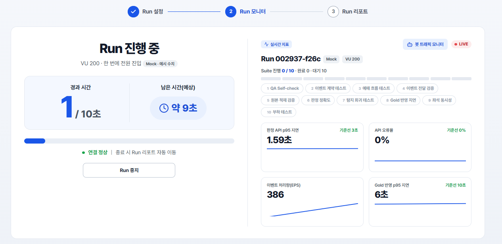

왼쪽에는 **지금까지 걸린 시간과 예상 남은 시간**, 오른쪽에는 **검사 진행 상태와 측정값**이 표시됩니다. 예를 들어 `API p95 지연 1.59초`는 측정한 요청의 약 95%가 1.59초 안에 응답했다는 뜻입니다. `이벤트 처리량(EPS)`은 초당 몇 건의 기록을 처리했는지 보여줍니다.

위 캡처는 **Mock 화면**이며, 표시된 숫자는 예시입니다.

<details>
<summary>Live에서는 지표를 어떻게 측정하나요?</summary>

| 실시간 모니터링 지표 | 측정·조회 방식 |
|---|---|
| 처리량 | 최근 30초에 `normalizedAt`이 기록된 정제 문서 수 ÷ 30초 |
| 데이터 신선도 지연(화면의 Gold 반영 지연) | 이벤트 발생 시각(`occurredAt`)과 정제 기록 시각(`normalizedAt`)의 차이. 최근 15분의 최대 5,000개 표본으로 p95를 계산하며, 표본이 없으면 건너뜀(Skipped)으로 표시 |
| 격리 건수 | 시스템 DB의 `quarantine_events` 전체 문서 수 |
| API 지연·오류율 | 시스템 기록의 측정 상태에 따라 값 또는 미측정 표시 |

측정 완료 여부와 합격 기준 충족 여부를 나누어 기록합니다. Mock 환경에서는 테스트 절차와 채점을 확인하고, Live 환경에서는 예매 웹·Kafka·MongoDB의 응답과 처리 기록을 조회합니다.

</details>

#### 3. Run 리포트 — 전체 결과를 보고 개별 사례를 찾습니다

먼저 **최종 판정**에서 이번 실행이 통과했는지 봅니다. 그다음 **Suite 자체 검증**에서 개별 검사의 결과를, **합격 기준**에서 측정값이 목표를 충족했는지 확인합니다. 오른쪽의 **오분류 판정**에는 시스템의 판정과 QA 정답표가 달랐던 사례가 표시됩니다.


**PASS 예시**에서는 검사 10개가 모두 통과했습니다. 합격 기준 7개 중 6개는 목표를 충족했고, 1개는 이번 검사의 적용 대상이 아니었습니다. 오른쪽의 **미탐 3건**은 봇을 놓친 사례가 3건이라는 뜻입니다. **오탐 0건**은 정상 관람객을 봇으로 잘못 판정한 사례가 없었다는 뜻입니다. 전체 실행이 통과한 뒤에도 미탐 사례를 열어 살펴볼 수 있습니다.

**FAIL이 나왔을 때**는 리포트의 개별 검사 결과부터 보면 어떤 항목이 실패했는지 찾을 수 있습니다. 아래 예시에서는 측정값이 없는 합격 기준과 실제로 실패한 부하 테스트가 함께 표시됩니다.

<details>
<summary>FAIL 예시 화면과 부하 테스트 실패 원인</summary>

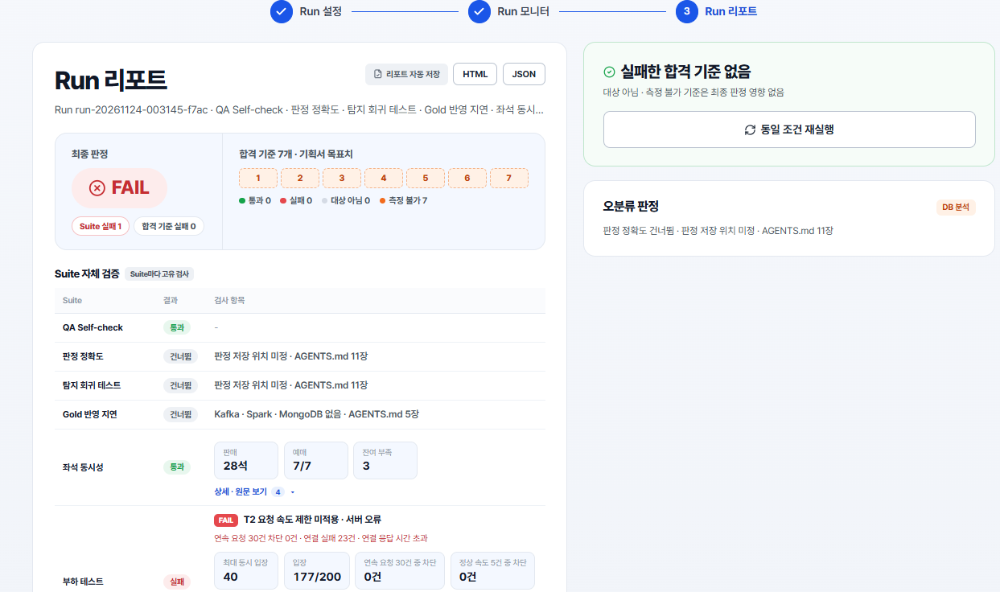

**FAIL 예시**에서는 합격 기준 7개가 모두 `측정 불가`로 표시됐습니다. `측정 불가`는 기준을 판정할 값이 확보되지 않은 상태입니다. 이번 실행의 실패 원인은 아래 **부하 테스트** 행에서 확인할 수 있습니다. 이 행에는 연속 요청 30건 중 차단 0건과 연결 실패 23건이 기록돼 있습니다. 상단에서 전체 판정을 보고 아래에서 실패한 검사를 찾으면, 어느 부분을 다시 확인해야 할지 알 수 있습니다.

</details>

<details>
<summary>스위트별 합격 기준과 보고서 저장 방식</summary>

합격 기준(Pass Criteria)은 기획 단계에서 정한 목표치를 사용합니다. 탐지 지표는 봇별로 따로 보지 않고 평가 그룹 단위로 합산해 계산합니다.

| 지표 | 정의 | 합격 기준 |
|---|---|---|
| 탐지율(Recall) | 매크로 그룹(봇 A·B·D·E·F·G) 세션 중 Challenge 이상 판정 비율 | 90% 이상 |
| 브라우저 자동화 탐지율 | 봇 C 세션 중 Challenge 이상 판정 비율 | 70% 이상 |
| 오탐률(FPR) | 정상 세션 중 Challenge 이상 판정 비율 | 1% 이하 |
| 판정 커버리지 | 비교 대상 세션 중 판정 기록을 받은 비율 | 90% 미만이면 측정 불가(Inconclusive) |
| 데이터 신선도 지연 | 서버 이벤트 `occurredAt`부터 정제 `normalizedAt`까지, 최근 15분·최대 5,000개 표본 | p95 10초 이내 |

Live 판정 리더는 서버 제한·단계 거절 기록과 `anomaly_events`를 세션별로 연결합니다. 서버 즉시 제한은 Hold, 단계 거절·이상 관측은 Challenge로 분류하고, 판정 기록은 최대 90초까지 기다립니다. 판정이 없는 봇 세션은 미탐(FN)으로 집계합니다.

| 테스트 스위트 | 검증 내용 | 합격 기준 | 부하 조건 |
|---|---|---|---|
| QA 자체 점검 | 채점·지표 계산 로직 | 기대값과 일치 | 트래픽 없음 |
| 이벤트 계약 | 이벤트 형식·필드·시간 계약 | 계약 케이스 26개 충족 | 고정 |
| 예매 흐름 | 로그인부터 예매 확정까지 E2E 진행 | 오류 0·중복 판매 0 | Run VU |
| 이벤트 전달 | Kafka 도착 | 유실 0·중복 0 | Run VU |
| 원본 적재 | 원문·분류·저장 정합성 | 유실·중복·오분류·변형 0 | Run VU |
| 탐지 정확도 | Ground Truth 대비 판정 | 탐지율·오탐률 기준 충족 | Run VU |
| 회귀 테스트 | 탐지 규칙 변경 전후 비교 | Baseline 대비 탐지율 하락·오탐률 상승 5%p 이내 | Run VU |
| 데이터 신선도 지연 | 정제 반영 시간 | p95 10초 이내 | 트래픽 없음 |
| 동시성 테스트 | 동일 좌석 동시 확정(Race Condition) | 1건만 성공·초과 판매 0 | 고정 20명 |
| 부하·스파이크 테스트 | 오픈 시점 집중 유입과 반복 재입장 | 입장 제한 유지·반복 재입장 차단·서버 오류 0 | Run VU |
| 복구 테스트 | 처리 작업 중단 후 복구 | RTO 60초 이내·유실·중복 0 | 트래픽 없음 |
| 장애 중 유실 검증 | 중단 중 유입 세션의 복구 후 판정 | 60초 이내 판정·유실 0 | Run VU |

| Run 설정 | Run 리포트 |
|---|---|
| 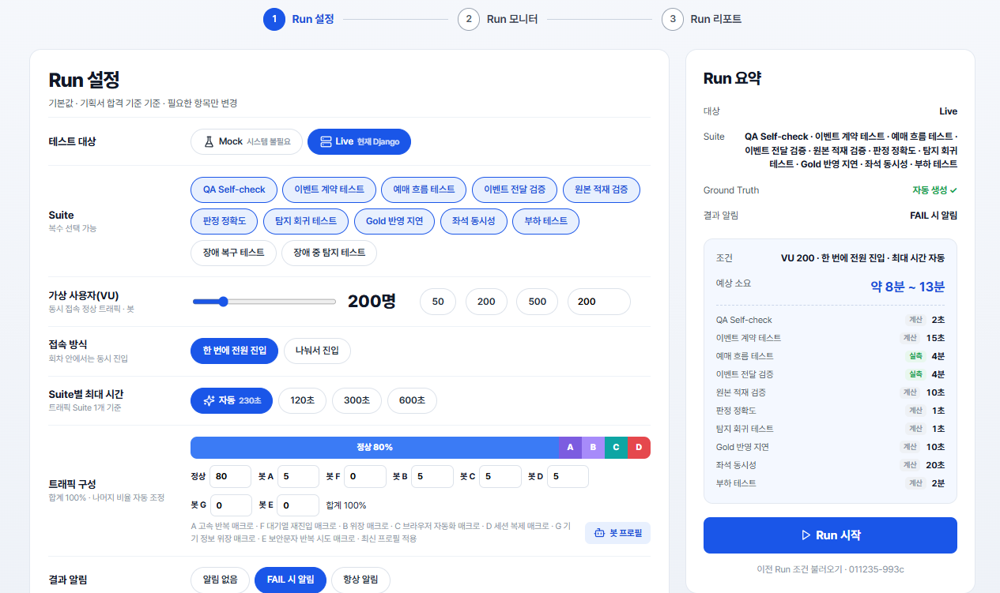 | 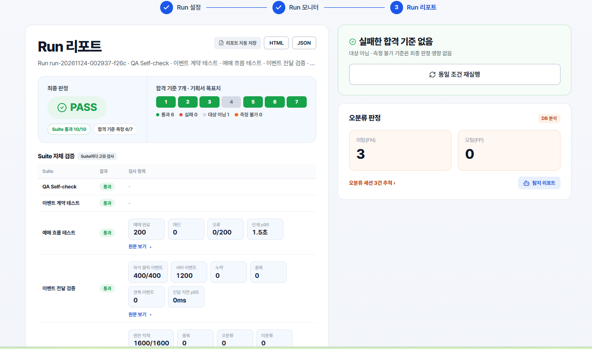 |

Run 기록·Ground Truth·봇 버전은 QA DB(`runs`, `answer_keys`, `bot_versions`, `bot_types`)에, HTML·JSON 리포트는 QA 데이터 볼륨에 저장합니다. 스위트 결과는 Pass·Fail·Skipped·Error로, 합격 기준별 결과는 충족·미충족·측정 불가·대상 아님으로 기록하며 미탐(FN)·오탐(FP) 세션 목록을 함께 남깁니다.

</details>

<details>
<summary>AWS 스테이징에서 확인한 시험 문제와 조치</summary>

EC2 Live 환경에서 확인한 이슈와 조치는 다음과 같습니다.

| 현상 | 원인 | 조치 |
|---|---|---|
| 후속 스위트의 예매가 모두 실패 | 같은 계정 반복 사용으로 구매 한도(4매) 초과, 5분 제한 | 계정 순환 배정, 서버 정책 제한을 오류와 분리 집계 |
| 이벤트 유실로 오판 | 서버 이벤트의 비동기 발행 지연 | 최대 60초 재조회 후 대조 |
| 판정 미수신 세션이 정상으로 집계 | 판정 저장 전에 대조 시작 | 판정 커버리지 확인, 미달 시 측정 불가 처리 |
| Run 진행 화면 중단 | 실행 중 브라우저 연결 끊김 | 진행 상태 자동 재연결 |

</details>

### 2.12 AWS 스테이징 환경과 인프라 코드

스테이징 서버는 AWS EC2 한 대에서 Docker Compose로 운영합니다. 외부에는 Nginx 게이트웨이만 공개하고, 관리자·QA 화면은 관리자 인증을 거쳐 연결합니다. 콘솔로 먼저 구축한 리소스 32개를 Terraform으로 import했으며, `terraform plan` 결과 `No changes`로 코드와 실제 상태의 일치를 확인했습니다.

| 구분 | 구성 |
|---|---|
| 컴퓨팅 | `ap-northeast-2`, EC2 `t3.medium`, Elastic IP, 루트 볼륨 암호화, IMDSv2 필수 |
| 네트워크 | 보안 그룹 인바운드 80 공개, 22·443 관리자 IP `/32`만 허용, MongoDB 포트 비공개 |
| DB 접근 | SSM Session Manager 포트 포워딩 문서 4개로만 접속 |
| IAM | EC2용 SSM 역할, 팀원별 서버 1대·지정 문서 단위 최소 권한 정책 |
| 변경 보호 | 보안 그룹·서버·고정 IP에 `prevent_destroy`, state·tfvars는 저장소 제외 |
| CI | `infra.yml`에서 `terraform fmt`·`validate`, `qa.yml`에서 QA 단위 테스트와 Mock Run |

구성도와 파일별 역할은 [인프라 안내](infra/terraform/README.md)에 정리했습니다.

### 2.13 확인한 결과

#### 예매·이벤트 전달 테스트

아래는 실제 예매 웹에서 50명이 예매를 시도한 결과입니다. 4주차 QA 구현 결과 보고서에 기록된 시험입니다. 이 시험에서는 예매 단계가 진행되는지와 예매 기록이 빠짐없이 전달되는지를 확인했습니다. 표의 `오류 0건`은 이 실행에서 예매 처리 오류가 없었다는 뜻입니다. 시스템이 봇을 얼마나 잘 찾아내는지는 별도의 판정 정확도 시험에서 확인합니다.

| 항목 | 결과 |
|---|---|
| 테스트 인원 | 정상 35명, 봇 E·F·G 각 5명, 총 50명 |
| 단계 진행 | 50명 모두 대기열·보안문자·좌석 선택 통과 |
| 예매 결과 | 확정 42명, 선호 좌석 소진에 따른 매진 8명, 오류 0건 |
| 좌석 클릭 이벤트 | 441건 중 441건 도착 |
| 서버 이벤트 | 799건의 누락·중복 0건 |
| 이벤트 전달 지연 | 해당 실행의 p95 36ms |
| 판매 정합성 | 해당 실행에서 같은 좌석 중복 판매 0건 |
| 보고 당시 테스트 상태 | Mock 환경 12개 스위트 Pass, Live 환경의 이벤트 계약·예매 흐름·이벤트 전달 3개 스위트 Pass |

해당 실행에서는 정상 사용자와 봇의 단계별 진행, 예매 확정, Kafka 이벤트 도착과 판매 정합성을 확인했습니다. 봇 15명의 예매 완료와 정상 사용자 8명의 선호 좌석 소진 결과도 기록했습니다. 이후 서버 즉시 정책과 Live 판정·지표 조회 경로를 추가했습니다.

<details>
<summary>저장·분석 시스템의 통합 시험과 지연 측정 기록</summary>

#### 원본 보관·파이프라인 통합 검증

| 검증 기록 | 시험 구성 | 확인한 결과 |
|---|---|---|
| 원본 적재 검증 | 독립 3파티션 토픽·14건 표본 | 종류별 라우팅, 부분 저장 실패 시 미커밋, 재수신 후 중복 없음 |
| DB 설치 검증 | 빈 볼륨 초기화·계정·인덱스 준비 | reader 쓰기 거부, 재시작 후 조회, 반복 설정 시 데이터·계정 유지 |
| flow 통합 검증 | 실제 Kafka 2파티션·원본 적재·인증 DB·Spark `local[2]`·공개 뷰 | 원본 대조, 지표 저장·공개, 관리자 읽기 계정 조회 |
| 같은 flow 시험의 입력·집계 | 합성 9건과 재전송 9건 | 고유 예매 시작·성공 각 3건, 시계열당 720개 시점 |
| 같은 flow 시험의 권한 | 관리자 reader 계정 | 내부 컬렉션 조회·쓰기 요청 거부 |

#### 처리 지연 측정 기록

격리 환경에서 합성 `receivedAt` 생성 직전부터 검증된 공개 문서를 관측할 때까지 측정했습니다. 각 회차에 40개 이벤트를 보내 3회에 걸쳐 관측했으며, Spark는 `local[2]`로 실행했습니다.

| 시험 구성 | 1회차 | 2회차 | 3회차 |
|---|---:|---:|---:|
| 초기 소규모 시험 | 2.649초 | 1.147초 | 1.136초 |
| 당시 시계열 저장 구조 반영 후 재시작 시험 | 6.349초 | 1.248초 | 1.654초 |

재시작 시험의 첫 회차에는 준비·재처리 구간이 포함되었습니다. 위 표는 각 구성에서 기록한 공개 관측 시간이며, 현재 사용자 흐름은 최근 1시간 시계열을 사용하는 구성입니다.

| 측정값 | 시작·종료 지점 |
|---|---|
| QA 보고서의 이벤트 전달 p95 36ms | 해당 Live 실행의 이벤트 발생부터 Kafka 도착 |
| 격리 파이프라인 공개 관측 시간 | 합성 `receivedAt` 생성 직전부터 공개 문서 관측 |
| 현재 QA의 정제 반영 지연 | 서버 이벤트 `occurredAt`부터 정제 기록 `normalizedAt` |

단위 검사에는 지연·역순 입력, 원본 누락·내용 불일치, 청크 재조립·재처리, 공개 실패, 부분 저장 후 재시도, 무이벤트 접속 만료 등의 사례를 구성했습니다. 통합 검사에서는 실제 Kafka·Spark·MongoDB를 연결해 원본 대조와 지표 공개를 확인했습니다.

</details>

## 3. 마무리

### 3.1 구현 결과와 프로젝트의 가치

TicketGuard는 **예매 행동의 생성부터 원본 보관, 분석, 근거 조회, 독립 채점까지 추적하는 구조**를 만들었습니다.

- **서비스:** 예매 흐름에서 반복 요청과 단계 위반을 다루고 서버 조치를 기록했습니다.
- **데이터:** 원문·전송 위치, 정제·격리, 분석 결과, 공개 상태를 연결했습니다.
- **운영:** 규칙·관측값·대상·시각·조치를 조회하는 관리자 화면을 구성했습니다.
- **검증:** Ground Truth를 분리한 트래픽과 QA로 예매 기능·데이터 품질·판정 결과를 평가하는 체계를 만들었습니다.

병렬 처리의 지연과 부분 실패를 다루는 과정에서 재시도·재계산·공개 상태 확인을 구현했습니다. 모의 시험과 실제 시험 결과를 기록해 기능 변경 후 비교할 기준을 남겼습니다.

### 3.2 작업을 통해 정리한 설계 기준

| 설계 기준 | 적용 내용 |
|---|---|
| 식별 기준 분리 | 이벤트 ID, 요청 ID, 예매 시도 ID, Kafka 전송 위치를 목적별로 사용 |
| 업무와 분석의 역할 분리 | 웹은 즉시 정책 적용, Spark는 관측·집계·이상 근거 생성 |
| 저장과 공개의 단계 분리 | 결과 저장 후 공개 버전 선택, 조회 시 상태·버전 확인 |
| 관측 단위 명시 | 요청·업무 사건·고유 시도·계정·탐지·조치를 각각 집계 |
| 장애 대응 상태 보관 | 체크포인트·MongoDB 복구 상태·Outbox 연결 |
| QA 독립성 | Ground Truth·봇 버전·실행 결과를 QA 전용 영역에서 관리 |
| 측정 범위 명시 | 전달·정제·공개 구간과 시험 구성을 결과에 기록 |

### 3.3 확장 방향

구현한 예매·분석·검증 구조를 바탕으로 다음 확장 방향을 정리했습니다.

| 확장 방향 | 추진 내용 |
|---|---|
| 탐지·정책 검증 확대 | 같은 봇 버전·시드·정책·자원으로 봇별 탐지율·오탐률·제한 결과 비교 |
| 종단 관측 | 발생·Kafka 도착·원본 저장·정제·버전 공개·화면 표시 시각 연결 |
| 튜닝 비교 | 처리 주기·배치 입력량·쓰기 묶음·상태 크기별 지연·처리량·자원 사용량 비교 |
| 장애 시험 확대 | Kafka·MongoDB·Spark 중단과 재기동, 부분 쓰기, 청크 지연 조합 |
| 집계 처리 확장 | 대상별 증분 집계와 상태·보존·차원 관리 개선 |
| 관측 출처 확대 | 게이트웨이·업스트림 상태와 브라우저 행동 연결 |
| 실행 환경 분리 | 컨테이너별 메모리 제한, QA 트래픽과 시스템 자원 분리, CloudWatch 알람·S3 백업·Terraform state 원격 보관 |
| 운영 기능 확장 | 기획사 리포트, 결제·취소·환불, 운영 회차와 이력 보존 정책 연결 |

이벤트 수집부터 독립 검증까지 연결한 구조를 활용해 운영자가 행동의 근거를 확인하고, 측정 결과를 바탕으로 대응 정책을 개선하는 서비스로 발전시키고자 합니다.

### 3.4 코드 구조와 상세 문서

```text
Ticket_Guard/
├── web/                 예매·회원가입·서버 정책·이벤트·MongoDB 업무 상태
├── templates/           예매 화면 템플릿
├── static/              화면 동작·스타일·브라우저 관측
├── raw_consumer/        Kafka 원문 보관과 컬렉션 라우팅
├── pipeline/            Spark ingest·flow·network·이상 관측·복구
├── admin_dashboard/     관리자 공개 결과 조회 앱
├── qa/                  트래픽·Ground Truth·봇·테스트 스위트·QA 대시보드
├── infra/               AWS 리소스 Terraform 코드
├── mongo/               MongoDB 초기화·권한·로컬 실행 설정
├── gateway/             관리자 인증 연결·Nginx 라우팅
├── docs/                구조도·연결·업무·검증 문서
└── .github/workflows/   CI 설정
```

| 주제 | 문서·코드 |
|---|---|
| 웹 상태·계정·실행 | [MongoDB 상태 저장 설정](docs/mongodb-state.md) |
| 예매 입장·대기열 | [예매 입장 제어](docs/booking-admission.md) |
| Kafka 전달·검증 | [Kafka 문서](docs/kafka.md) |
| MongoDB 연결 | [MongoDB 문서](docs/mongodb.md) |
| 원본 적재 검증 | [원본 적재 검증 기록](raw_consumer/VALIDATION.md) |
| Spark 실행·구성 | [파이프라인 안내](pipeline/README.md) |
| 사용자 흐름 | [사용자 흐름 구현·실행](pipeline/docs/user_flow.md) |
| 결과 저장·조회 | [데이터 계약](pipeline/docs/contract.md) |
| 네트워크 관측 | [네트워크 상태](pipeline/docs/network_status.md) |
| 이상 관측 | [이상 관측·게시 계약](pipeline/docs/anomaly.md) |
| 사전 모니터링 | [조기 탐지 관측](pipeline/docs/early_monitor.md) |
| 서버 즉시 정책 | [사전 제한과 단계별 탐지](pipeline/docs/prevention.md) |
| 파이프라인 시험·측정 | [검증 이력과 측정 조건](pipeline/docs/validation.md) |
| 관리자 앱 | [관리자 안내](admin_dashboard/README.md)·[현재 라우트](admin_dashboard/src/ticket_guard_admin/app.py) |
| 관리자 자동 갱신 | [공개 지표 재조회 코드](admin_dashboard/src/ticket_guard_admin/static/monitor_refresh.js) |
| QA 실행 | [QA 안내](qa/README.md) |
| QA 봇 유형 | [기본 봇 카탈로그](qa/src/ticket_guard_qa/macro_bots/bot_catalog.py) |
| QA 판정·지연·처리량 | [시스템 MongoDB 조회 코드](qa/src/ticket_guard_qa/system_targets/live_mongo_reader.py) |
| AWS 인프라 | [Terraform 안내](infra/terraform/README.md) |
