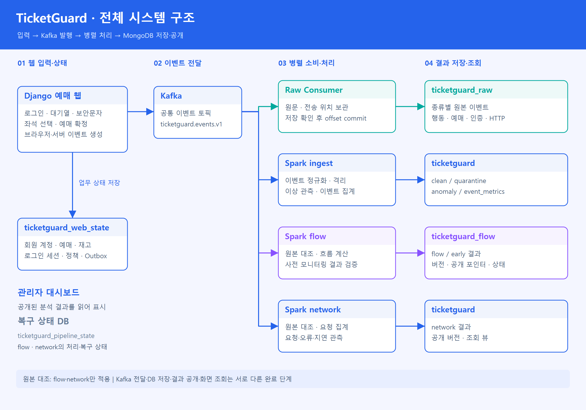
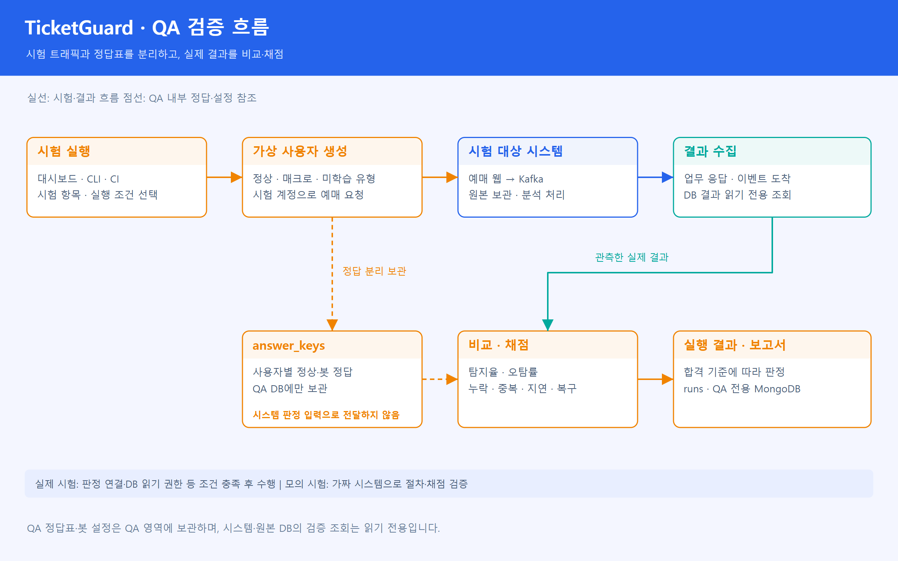

# TicketGuard · 티켓가드

> 공연 예매 행동 데이터를 수집·분석하고, 의심 행동의 근거와 처리 품질을 독립된 QA로 검증하는 프로젝트입니다.

TicketGuard는 직접 구현한 예매 웹에서 정상 사용자와 매크로의 행동을 재현하고, **Kafka·Spark·MongoDB로 원본 보관부터 정제·이상 관측·지표 공개까지 연결한 실시간 데이터 처리 시스템**입니다. 웹 서버는 요청 시점에 정책을 적용하고, Spark는 행동과 서버 처리 기록을 분석합니다. 운영자는 관리자 대시보드에서 결과와 근거를 확인하며, QA는 정답표와 시스템 결과를 비교합니다.

## 1. 서론

### 1.1 프로젝트 시작 배경

공연 예매는 오픈 직후 짧은 시간에 요청이 집중되고, 한정된 좌석을 여러 사용자가 동시에 선택하는 서비스입니다. 자동화 프로그램의 빠른 진입과 반복 요청은 일반 이용자의 예매 기회에 영향을 줍니다.

팀은 **구매 과정에서 발생하는 행동을 연결해 의심 신호를 확인하고, 판단 근거를 기록하는 서비스**를 기획했습니다. 예매 순서와 요청 간격, 대기열 재진입, 보안문자 시도, 좌석 선택, 실제 구매 결과를 함께 살펴보는 방식입니다.

프로젝트의 핵심 과제는 다음과 같습니다.

1. 예매 과정의 행동과 서버 업무 결과를 연결하는 이벤트 수집 구조 구현
2. Kafka·Spark·MongoDB를 연결한 원본 보관·정제·집계 파이프라인 구축
3. 반복 요청과 단계 위반에 대한 서버 정책 및 이상 관측 구현
4. 운영자가 지표와 탐지 근거를 확인하는 관리자 화면 구성
5. 정상·봇 트래픽과 정답표를 이용한 자동 QA 구축

### 1.2 예매 웹과 QA를 함께 만든 이유

예매 단계별 행동, 실패·재시도의 원인, 정상·봇 여부를 함께 확인할 데이터를 확보하기 위해 예매 웹과 QA를 직접 구현했습니다.

예매 웹은 로그인, 공연 조회, 대기열, 보안문자, 좌석 선택, 예매 확정의 흐름을 제공합니다. QA는 시험 계정으로 이 흐름을 수행하며 정상 사용자와 여러 유형의 매크로 행동을 재현합니다.

정답표와 봇 설정은 QA 영역에 보관하고, 시스템에는 예매 요청과 관측 이벤트를 전달합니다. 시스템이 처리한 결과를 QA가 정답표와 대조하는 독립 검증 구조를 구성했습니다.

### 1.3 구현한 기능과 데이터

| 구현 영역 | 작업 내용 | 다루는 데이터 |
|---|---|---|
| 예매 서비스 | 회원가입·로그인, 공연 탐색, 대기열, 보안문자, 좌석·인원 선택, 예매 확정·내역 | 계정, 예매 시도, 재고, 구매 기록, 정책 상태 |
| 관측·전달 | 브라우저 행동과 서버 업무·HTTP 관측, 민감값 정제, Kafka 발행 | 화면 이동, 클릭·선택, 요청·응답, 성공·실패, 시각 |
| 원본 보관 | 원문과 전송 위치 보관, 종류별 라우팅, 저장 확인 후 커밋 | 원문 바이트, 출처, 토픽, 파티션, 오프셋 |
| 스트리밍 분석 | 정제·격리, 사용자 흐름, 요청 상태, 이상 관측·사전 모니터링 | 최소 관측값, 지표, 규칙·버전, 근거, 처리 상태 |
| 관리자 화면 | 사용자 흐름·네트워크 상태·이상탐지, 단계별 탐지·조치 조회 | 공개 결과, 기준 시각, 대상·근거·상태 |
| 자동화 QA | 트래픽 생성, 정답표 대조, 전달·적재·지연·회귀·복구 시험 | Run, 시험 항목, 봇 버전, 측정값·결과 |

### 1.4 팀 구성과 역할

### 1.4 팀원 소개

### 1.4 팀원 소개

### 1.4 팀원 소개

<table width="100%">
  <tr>
    <td align="center" width="33%">
      <br />
      <a href="https://github.com/callijee22-ship-it">
        
      </a>
      <p><strong>류지예</strong></p>
      <p><sub>팀장 · Frontend & UI</sub></p>
      <a href="https://github.com/callijee22-ship-it">
        
      </a>
      <br /><br />
    </td>
    <td align="center" width="33%">
      <br />
      <a href="https://github.com/seoloo">
        
      </a>
      <p><strong>설호현</strong></p>
      <p><sub>QA & Automation</sub></p>
      <a href="https://github.com/seoloo">
        
      </a>
      <br /><br />
    </td>
    <td align="center" width="33%">
      <br />
      <a href="https://github.com/SeokHwanHong">
        
      </a>
      <p><strong>홍석환</strong></p>
      <p><sub>Data Engineering</sub></p>
      <a href="https://github.com/SeokHwanHong">
        
      </a>
      <br /><br />
    </td>
  </tr>
  <tr>
    <td align="center" valign="top">
      <br />
      <strong>화면 구성 · 사용자 경험</strong>
      <br /><br />
      사용자·관리자 UI 및 테마<br />
      회원가입·로그인·예매 화면<br />
      예외 상황 안내 및 화면 동작<br />
      예매 일정·좌석 초기화<br />
      README·구조도·발표자료
      <br /><br />
    </td>
    <td align="center" valign="top">
      <br />
      <strong>자동화 시험 · 결과 검증</strong>
      <br /><br />
      QA 대시보드·시험 항목<br />
      정상·매크로 트래픽<br />
      Mock·Live 실행 및 결과 UI<br />
      QA MongoDB 구성<br />
      AWS 업로드·실행 환경
      <br /><br />
    </td>
    <td align="center" valign="top">
      <br />
      <strong>데이터 처리 · 이상 관측</strong>
      <br /><br />
      MongoDB 구조·계정 구성<br />
      Kafka·Spark 및 원본 적재<br />
      사용자 흐름·네트워크 지표<br />
      사전 탐지·사후 처리<br />
      관리자 지표 연결·UI 개선
      <br /><br />
    </td>
  </tr>
</table>

프로젝트 흐름과 웹페이지 기획·구성은 팀이 함께 논의하고, 각 담당 영역을 연결해 예매·수집·분석·조회·검증 흐름을 구성했습니다.

## 2. 과정

### 2.1 전체 아키텍처와 설계 의도

**업무 처리, 원본 보관, 분석, 결과 조회, QA 채점을 역할별로 분리하고 같은 이벤트의 근거로 연결**했습니다.



예매 웹은 업무 요청을 처리하며 Kafka의 공통 토픽 `ticketguard.events.v1`로 이벤트를 발행합니다. Kafka 이후에는 Raw Consumer와 Spark 작업이 병렬로 이벤트를 소비합니다.

| 구성요소 | 담당 역할 |
|---|---|
| 예매 웹 | 업무 처리, 서버 정책 적용, 브라우저·서버 이벤트 생성 |
| Kafka | 공통 이벤트 전달과 소비 경로 분리 |
| Raw Consumer | 원문·전송 위치 보관, 종류별 컬렉션 라우팅 |
| Spark ingest | 정제·격리, 이벤트 집계, 이상 관측 저장 |
| Spark flow | 원본 대조, 사용자 흐름 계산, 사전 모니터링 |
| Spark network | 원본 대조, 서버 요청 상태 집계 |
| 관리자 대시보드 | 공개된 지표와 탐지·조치 근거 조회 |
| QA | 트래픽 생성, 결과 수집, 정답표 대조·채점 |

`flow`와 `network`는 자신이 소비한 Kafka 입력을 저장된 원본과 대조합니다. Kafka 전달, 원본 저장, 분석 처리, 결과 공개, 브라우저 표시를 각각의 완료 단계로 관리해 이벤트의 처리 위치를 확인하도록 구성했습니다.

### 2.2 기술 스택

| 영역 | 기술 |
|---|---|
| Frontend |      |
| Backend |     |
| Database |   |
| Messaging |   |
| Data Processing |    |
| Infrastructure |    |
| Testing & QA |     |
| CI |  |

Frontend는 HTML·CSS·JavaScript와 서버 템플릿으로 예매·관리자·QA 화면을 구성합니다. Backend는 Django의 예매 업무·인증과 FastAPI의 관리자·QA 앱으로 역할을 나눕니다. Kafka는 이벤트 전달을, Spark는 정제·집계·이상 관측을 담당하며, MongoDB는 데이터를 용도별로 보관합니다.

### 2.3 데이터 수집과 Kafka 전달

브라우저에서는 화면 진입·이탈, 검색, 공연·회차·좌석 선택과 관측 가능한 요청·응답·성능·오류를 수집합니다. 서버에서는 로그인·예매 업무 결과와 HTTP 요청 처리 관측을 기록합니다.

| 식별·시간 정보 | 사용 목적 |
|---|---|
| `eventId` | 동일 이벤트의 재전달과 중복 확인 |
| `bookingAttemptId` | 한 번의 예매 시도에 속한 업무·판정 연결 |
| `pageInstanceId` | 브라우저 페이지 관측과 사용자 흐름 연결 |
| `observationRequestId` | 서버 수신 요청과 관련 업무 사건 연결 |
| `userId`, `showId`, `scheduleId` | 계정·공연·회차별 분석 범위 구분 |
| `occurredAt`, `receivedAt`, `normalizedAt` | 발생·수신·정제 시점 및 구간별 지연 계산 |
| Kafka 출처·토픽·파티션·오프셋 | 원문 위치와 분석 입력의 대응 확인 |

민감값은 관측 단계에서 정제하고, 브라우저와 서버의 출처를 구분해 기록합니다. 큰 관측 이벤트는 청크로 나누어 전달하며 분석 경로에서 재조립 상태를 관리합니다.

웹의 정책·구매·계정 관련 이벤트는 MongoDB 트랜잭션과 Outbox를 사용해 업무 상태와 연결합니다. 대기 이벤트는 전송 성공까지 보관하고 Kafka 장애 이후 재전송하도록 구성했습니다.

### 2.4 원본 보관, 정제와 결과 공개

#### 원본 보관

Raw Consumer는 원문 바이트와 Kafka 전송 위치를 보존합니다. 이벤트 종류에 따라 `behavior_events`, `booking_events`, `auth_events`, `http_events`, `raw_chunks`, `unclassified_events` 등의 컬렉션으로 분류합니다.

저장 성공을 확인한 뒤 오프셋을 커밋하고, 부분 저장 실패 후 재수신한 입력은 동일 전송 위치를 기준으로 멱등 저장합니다.

#### 정제·격리와 분석

| 처리 경로 | 처리 내용 | 저장 결과 |
|---|---|---|
| `ingest` | 이벤트 해석·정규화, 정상·격리 분리, 이상 관측·집계 | `clean_events`, `quarantine_events`, `event_metrics`, `anomaly_*` |
| `flow` | 원본 대조, 청크 재조립, 단계·활동·예매 결과 계산 | `flow_versions`, `flow_series`, `flow_public`, `early_*` |
| `network` | 원본 대조, 요청 ID별 중복 제거, 서버 요청 상태 집계 | `network_versions`, `network_series`, `network_public`, 조회 뷰 |

형식 검증에 실패한 자료는 격리합니다. 정제된 이벤트에서 행동상 이상 신호가 발견되면 해당 이벤트에 별도의 이상 근거를 연결합니다. 형식 검증과 행동 분석을 나누어 관리하는 구조입니다.

#### 결과 공개

사용자 흐름과 네트워크 결과는 버전별 결과를 저장한 뒤 공개 포인터로 조회할 버전을 지정합니다. 사전 모니터링도 불변 버전과 공개 포인터·health 상태를 사용합니다. 이상 관측은 공개 문서와 health의 게시 시각·규칙 버전을 대조합니다.

부분 쓰기나 버전 불일치가 발생하면 새 결과의 공개를 보류하고, 조회 측에서도 공개 상태와 일관성을 확인합니다. 각 결과 계열의 저장·조회 계약에 맞춰 공개 절차를 구현했습니다.

### 2.5 데이터 저장 구조

| 논리 DB | 역할 | 대표 데이터 |
|---|---|---|
| `ticketguard_web_state` | 예매 업무와 서버 정책 상태 | 계정·가입 기록, 예매 시도·내역, 재고, 구매 원장, 로그인 세션, Outbox |
| `ticketguard_pipeline_state` | 분석 작업의 처리·복구 상태 | 청크, 재조립 결과, 최소 관측, 배치·복구 위치·guard |
| `ticketguard_raw` | 원본 보관 | 종류별 원문, Kafka 출처·전송 위치 |
| `ticketguard` | 정제·격리·이상 관측·요청 분석 | 정제·격리 이벤트, 이상 근거, 네트워크 결과 |
| `ticketguard_flow` | 사용자 흐름·사전 모니터링 | 흐름·탐지·조치 근거·공개 버전 |
| `ticketguard_qa` | 독립 시험과 채점 | Run, 정답표, 봇 유형·버전, 내보내기 이력 |
| `ticketguard_qa_archive` | 선택적 종료 시험 전달 | 승인된 종료 시험과 선택한 전달 자료 |

기본 논리 DB 6개와 선택적 전달 DB 1개를 구성하고, 역할별 연결과 권한을 분리했습니다. 실제 DB 이름과 접속 대상은 환경 설정으로 관리합니다.


위 그림은 주요 예매·구매·정책 컬렉션의 논리 참조 관계입니다. 계정·가입 기록은 `accounts`·`account_events`, 재고는 `booking_inventory`, 로그인 세션은 `web_sessions`, 전송 대기 이벤트는 `outbox`에서 관리합니다. 구매 원장과 취소·환불 수량 조정을 연결하는 저장 계약도 구현했습니다.

### 2.6 지연 이벤트와 장애 복구

원본 적재 지연, 이벤트 도착 순서 변화, 일부 문서 저장 후 작업 중단에 대응하도록 재시도·재계산·멱등 저장·공개 상태 관리를 구현했습니다.

| 처리 상황 | 구현한 대응 |
|---|---|
| 원본 적재 지연 | 기본 최대 10초 동안 0.25초 간격으로 원본 대조 재시도, 대조 결과에 따른 공개 상태 관리 |
| 지연·역순 이벤트 | 발생 시각과 식별자를 기준으로 보존 범위 안에서 재계산 |
| 네트워크 구간의 지연 도착 | 완료된 5분 구간 12개에 속하는 자료를 다음 게시 버전에 반영 |
| 뒤늦게 확인된 좌석 경쟁·재고 부족 | 추가 근거에 따라 기존 이상 신호를 철회 상태로 정정하고 이력 유지 |
| 청크 재조립 대기 | 조각과 재조립 상태 보관, 완료 여부에 따른 공개 제어 |
| 원본 부분 저장 후 실패 | 저장 확인 후 오프셋 커밋, 재수신 시 멱등 저장 |
| Spark 배치·결과 저장 실패 | 체크포인트와 복구 상태를 이용한 재처리, 미완료 결과의 공개 보류 |
| Kafka 전송 실패 | 웹 Outbox에 전송 대기 이벤트 보관 후 재전송 |
| 관측 공백 | 시계열에 미관측 상태와 `null` 기록 |

Spark 체크포인트는 소비 진행 위치를, 전용 MongoDB 상태는 파생 관측·배치·청크 등 복구 정보를 관리합니다. 재시작 시 기존 체크포인트와 저장된 상태를 연결해 처리를 이어가도록 구성했습니다.

이상 관측과 사전 모니터링은 최근 2시간의 판정 갱신 범위와 추가 300초의 비교 유예를 사용하며, 화면에는 최근 1시간의 결과를 공개합니다.

### 2.7 설정 개선과 튜닝 과정

처리 주기, 배치 입력량, DB 쓰기 묶음, 원본 대기와 상태 크기를 조정할 지점을 분리했습니다.

| 항목 | 코드 기준 기본값·구성 | 적용 목적 |
|---|---|---|
| ingest 처리 주기 | `SPARK_TRIGGER_SECONDS=5`초 | 정제·적재 마이크로배치 실행 |
| flow 처리 주기 | `FLOW_TRIGGER_SECONDS=1`초 | 사용자 흐름 갱신 |
| 배치 입력량 | `SPARK_MAX_OFFSETS_PER_TRIGGER=1000` | 배치당 Kafka 입력량 관리 |
| ingest DB 쓰기 묶음 | `SPARK_MONGO_BULK_SIZE=200` | 문서 쓰기를 묶음 처리 |
| ingest DB 쓰기 시도 | `SPARK_MONGO_WRITE_ATTEMPTS=3` | 재시도 가능한 DB 쓰기 오류 대응 |
| ingest 셔플 파티션 | `spark.sql.shuffle.partitions=2` | 현재 실행 구성의 파티션 설정 |
| flow 원본 대기 | 기본 최대 10초 | 병렬 소비에 따른 원본 적재 지연 대응 |
| flow 시계열 | 최근 1시간, 5초 격자, 시계열당 720개 시점 | 조회 기간과 시계열 크기 관리 |
| 관리자 재조회 | 30초 | 공개 지표의 화면 갱신 |

사용자 흐름은 1초 처리 주기와 5초 시계열 격자로 구성하고, 관리자 화면은 30초마다 공개 결과를 재조회합니다. 네트워크 경로는 5초 처리 주기·배치 입력 상한 1,000개를 사용합니다. 실행 시 조정 가능한 값은 환경 설정으로 관리합니다.

| 개선 대상 | 작업 내용 | 확인한 결과 |
|---|---|---|
| 원본 적재 시작 지연 | 약 1초였던 원본 대기를 기본 최대 10초의 설정과 재시도로 구성 | 보완 후 격리 통합 시험의 원본 대조·공개 경로 확인 |
| 토픽 준비 순서 | 선행 토픽 준비 서비스로 소비 시작 순서 정리 | 최종 격리 프로젝트에서 전체 처리 경로 확인 |
| 시계열 중복 저장 | 요약과 시계열을 분리하고 버전·포인터로 공개 | 요약 문서와 시계열의 저장 구조 분리 |
| 부분 저장과 공개 | 저장 완료 후 공개하고 health·버전·시각 대조 | 미완료 상태와 이전 공개 결과를 구분하는 조회 경로 구현 |
| 누적 상태·문서 크기 | 관측 수·차원 수·문서 크기의 안전 상한 검사 | 상한 초과 시 작업 실패와 공개 보류 처리 |

이 과정에서 원본 적재와 분석의 시작 순서를 맞추고, 시계열 저장 구조와 공개 절차를 정리했습니다. 처리 지연 측정 결과는 2.12절에 시험 구성별로 정리했습니다.

### 2.8 이상탐지와 서버 정책

| 구분 | 처리 위치·시점 | 담당 역할 |
|---|---|---|
| 서버 즉시 정책 | 웹 요청 처리 시점 | 반복 위반과 구매 한도 판단, 요청 제한 |
| 사전 관찰 | Spark flow의 사전 모니터링 | 요청·탐지·서버 조치 집계, 관찰 신호 게시 |
| 이상 관측·사후 분석 | Spark ingest | 서버 요청과 구매 결과의 시간·횟수·수량 분석 |

#### 서버 즉시 정책

웹 서버가 요청 처리 시점에 다음 기준으로 판단하며, 적용한 정책과 버전을 이벤트에 함께 기록합니다.

| 정책 | 적용 기준 | 적용 단위 |
|---|---|---|
| 반복 로그인 실패 | 계정 누적 5회, 성공 시 초기화 | 계정과 실제·시뮬레이션 구분 |
| 오픈 전 반복 요청 | 직전 2초 내 `NOT_OPEN` 시작 요청 10회 | 계정·공연·회차·자료 구분 |
| 반복 재입장 | 직전 2초 내 새로운 예매 시도 10개 | 계정·공연·회차·자료 구분 |
| 반복된 잘못된 선택 | 직전 5초 내 지정된 선택 오류 10회 | 예매 시도와 계정·공연·회차 |
| 구매 한도 초과 시도 | 유효 구매량과 요청량의 합이 4매 초과 | 계정·공연·회차·자료 구분 |

각 제한은 300초로 관리하며 적용 시점의 만료 시각을 유지합니다. 선택 오류는 지정된 조건으로 집계하고, 좌석 경쟁·재고 부족·통신·서버 오류는 사유별로 구분합니다. 보안문자·단계·페이지 소유권 검사도 함께 적용합니다.

#### Spark 이상 관측

서버 요청 처리 구간 중첩, 동일 시도의 빠른 재요청, 다중 페이지 구매 요청, 빠른 예매 완료, 반복 구매, 관측 시간창 내 구매 수량을 확인합니다. 규칙별 활성 여부와 기준값은 설정으로 관리합니다.

사전 모니터링은 **확정 요청 3초 내 10회**를 관찰 전용 규칙으로 집계합니다. 웹 서버는 즉시 정책에 따른 요청 제한을 담당하고, Spark는 관찰 신호와 서버의 실제 조치를 각각 게시합니다.

탐지 결과에는 규칙·버전·기준값·관측값·관련 이벤트를 남깁니다. 평가·지연 대기·철회 등 상태와 고유 시도·신호 수를 구분해 관리합니다. 이 근거를 QA의 정답표와 연결해 채점하는 구조를 구성했습니다.

### 2.9 관리자 대시보드

팀 게이트웨이에서 예매 웹의 관리자 세션을 확인한 뒤 `/admin/`으로 연결합니다.

| 관점 | 화면 내용 |
|---|---|
| 사용자 흐름 `/admin/#flow` | 단계별 활동 접속, 체류·전환, 예매 시작·성공, 시계열 |
| 네트워크 상태 `/admin/#network` | 서버 요청·오류·응답 관련 수치와 구간별 추이 |
| 이상탐지 `/admin/#anomaly` | 사전 탐지·사후 처리, 감지 목록, 계정 타임라인, 구매 사례 |
| 단계별 탐지 | 로그인, 예매 시작·대기열, 좌석·인원 선택, 예매 확정의 탐지·조치 상세 |

`/admin/metrics`를 30초마다 재조회하고, 실패 시 이전 화면과 실패 상태를 유지하며 다음 주기에 재시도합니다. 미공개·오래된 자료·구버전 집계 미반영 등 데이터 상태도 함께 표시합니다.

활동 접속은 최근 30초 활동을 기준으로 계산합니다. 요청 수, 업무 사건 수, 고유 시도 수, 계정 수, 탐지 수, 조치 수는 각각의 단위로 표시합니다.

### 2.10 QA 봇·매크로 봇의 이동과 검증



1. **시험 구성:** Run의 시험 항목, 사용자 수, 봇 유형과 행동 버전 선택
2. **정답 보관:** 정상·봇 여부를 QA DB의 정답표에 기록
3. **예매 수행:** 시험 계정으로 로그인 후 공연·회차 확인, 대기열, 보안문자, 좌석·인원 선택, 예매 확정 진행
4. **행동 차이 생성:** 유형별 조회 생략, 반복 요청, 취소·재진입, 기기 정보 변경 수행
5. **결과 수집:** 업무 응답, Kafka 도착, 원본·정제·판정 기록 조회
6. **채점:** 예매 시도 등 연결 기준으로 정답과 결과를 대조하고 지표 계산

기본 유형은 정상 1종, 매크로 7종, 미학습 4종입니다. 사용자 정의 봇 유형과 행동 버전을 추가로 관리하는 기능도 구현했습니다.

| 유형 | 재현한 행동 | 검증 방향 |
|---|---|---|
| 정상 | 시작 시각과 클릭 간격이 분산된 예매 | 정상 흐름·오탐률 기준 |
| 봇 A | 고속·정주기 요청 반복 | 빠른 반복과 화면 조회 없는 진행 |
| 봇 B | 사람 수준 속도와 일정한 간격 | 일정한 행동 패턴 |
| 봇 C | 브라우저 버튼 자동 클릭 | 화면 이벤트가 존재하는 자동화 |
| 봇 D | 동일 기기의 여러 계정·창 동시 진입 | 동시 세션·페이지 관측 |
| 봇 E | 보안문자 오답·새로 받기 반복 | 반복 시도와 제한 동작 |
| 봇 F | 대기열 진입·취소·재진입 반복 | 시도 변화·재진입 |
| 봇 G | 세션별 기기·브라우저 정보 변경 | 정보 변경에 따른 관측과 판정 |
| 미학습 4종 | 기존 규칙 설계에 사용한 패턴과 다른 조합 | 새로운 행동 조합의 판정 결과 |

보안문자 시험은 시험용 조건에서 반복 시도와 제한 동작을 확인하도록 구성했습니다.


정답표·봇 설정·진행 중 시험은 QA 전용 영역에 보관합니다. 승인된 종료 시험의 전달은 별도 영역으로 관리하며, 전달할 정답표와 봇 버전을 선택하는 절차를 구현했습니다.

### 2.11 QA 시험 구성과 Live 지표

| 시험 항목 | 확인 내용 |
|---|---|
| QA 자체 점검 | 채점과 지표 계산 |
| 이벤트 계약 | 이벤트 형식·필드·시간 계약 |
| 예매 흐름 | 단계 진행과 예매 결과 |
| 이벤트 전달 | Kafka 도착과 누락·중복 |
| 원본 적재 | 원문·분류·저장 정합성 |
| 판정 정확도 | 정답표 대비 탐지율·오탐률 |
| 탐지 회귀 | 규칙 변경 전후 결과 |
| Gold 반영 지연 | 시스템 저장 기록 기준 반영 시간 |
| 좌석 동시성 | 동일 좌석 동시 확정·초과 판매 |
| 부하 | 집중 요청과 정책 동작 |
| 장애 복구 | 중단 후 복구와 데이터 정합성 |
| 장애 중 탐지 | 중단 중 유입된 세션의 복구 후 판정 |

서버 제한·단계 거절 기록과 `anomaly_events`를 세션별로 연결하는 Live 판정 리더를 구현했습니다. QA는 시스템의 규칙·판정 단계·시각을 읽고 정답표와 대조합니다.

| Live 지표 | 측정·조회 방식 |
|---|---|
| 처리량 | 최근 30초에 `normalizedAt`이 기록된 정제 문서 수 ÷ 30초 |
| Gold 반영 지연 | 서버 이벤트의 `occurredAt`부터 `normalizedAt`까지, 최근 15분·최대 5,000개 표본 |
| 격리 건수 | 시스템 DB의 `quarantine_events` 전체 문서 수 |
| API 지연·오류율 표시 | 시스템 기록의 측정 상태에 따라 값 또는 미측정 상태 표시 |
| 지연 표본 상태 | 표본이 있는 실행은 p95 계산, 표본이 없는 실행은 건너뜀 표시 |

처리량과 반영 지연은 시간창 기준으로 조회합니다. 측정 완료 상태와 합격 기준 판정을 나누어 결과에 기록합니다. 모의 환경에서는 시험 절차와 채점을 확인하고, 실제 환경에서는 예매 웹·Kafka·MongoDB의 응답과 처리 기록을 조회합니다.

### 2.12 확인한 결과

#### 예매·이벤트 전달 시험

4주차 QA 구현 결과 보고서에 기록한 Live 시험 결과입니다.

| 항목 | 결과 |
|---|---|
| 시험 인원 | 정상 35명, 봇 E·F·G 각 5명, 총 50명 |
| 단계 진행 | 50명 모두 대기열·보안문자·좌석 선택 통과 |
| 예매 결과 | 확정 42명, 선호 좌석 소진에 따른 매진 8명, 오류 0건 |
| 좌석 클릭 이벤트 | 441건 중 441건 도착 |
| 서버 이벤트 | 799건의 누락·중복 0건 |
| 이벤트 전달 지연 | 해당 실행의 p95 36ms |
| 판매 정합성 | 해당 실행에서 같은 좌석 중복 판매 0건 |
| 보고 당시 시험 상태 | 모의 환경 12개 항목 합격, 실제 환경의 이벤트 계약·예매 흐름·이벤트 전달 3개 항목 합격 |

해당 실행에서는 정상 사용자와 봇의 단계별 진행, 예매 확정, Kafka 이벤트 도착과 판매 정합성을 확인했습니다. 봇 15명의 예매 완료와 정상 사용자 8명의 선호 좌석 소진 결과도 기록했습니다. 이후 서버 즉시 정책과 Live 판정·지표 조회 경로를 추가했습니다.

#### 원본 보관·파이프라인 통합 검증

| 검증 기록 | 시험 구성 | 확인한 결과 |
|---|---|---|
| 원본 적재 검증 | 독립 3파티션 토픽·14건 표본 | 종류별 라우팅, 부분 저장 실패 시 미커밋, 재수신 후 중복 없음 |
| DB 설치 검증 | 빈 볼륨 초기화·계정·인덱스 준비 | reader 쓰기 거부, 재시작 후 조회, 반복 설정 시 데이터·계정 유지 |
| flow 통합 검증 | 실제 Kafka 2파티션·원본 적재·인증 DB·Spark `local[2]`·공개 뷰 | 원본 대조, 지표 저장·공개, 관리자 읽기 계정 조회 |
| 같은 flow 시험의 입력·집계 | 합성 9건과 재전송 9건 | 고유 예매 시작·성공 각 3건, 시계열당 720개 시점 |
| 같은 flow 시험의 권한 | 관리자 reader 계정 | 내부 컬렉션 조회·쓰기 요청 거부 |

#### 처리 지연 측정 기록

격리 환경에서 합성 `receivedAt` 생성 직전부터 검증된 공개 문서를 관측할 때까지 측정했습니다. 각 회차에 40개 이벤트를 보내 3회에 걸쳐 관측했으며, Spark는 `local[2]`로 실행했습니다.

| 시험 구성 | 1회차 | 2회차 | 3회차 |
|---|---:|---:|---:|
| 초기 소규모 시험 | 2.649초 | 1.147초 | 1.136초 |
| 당시 시계열 저장 구조 반영 후 재시작 시험 | 6.349초 | 1.248초 | 1.654초 |

재시작 시험의 첫 회차에는 준비·재처리 구간이 포함되었습니다. 위 표는 각 구성에서 기록한 공개 관측 시간이며, 현재 사용자 흐름은 최근 1시간 시계열을 사용하는 구성입니다.

| 측정값 | 시작·종료 지점 |
|---|---|
| QA 보고서의 이벤트 전달 p95 36ms | 해당 Live 실행의 이벤트 발생부터 Kafka 도착 |
| 격리 파이프라인 공개 관측 시간 | 합성 `receivedAt` 생성 직전부터 공개 문서 관측 |
| 현재 QA의 정제 반영 지연 | 서버 이벤트 `occurredAt`부터 정제 기록 `normalizedAt` |

단위 검사에는 지연·역순 입력, 원본 누락·내용 불일치, 청크 재조립·재처리, 공개 실패, 부분 저장 후 재시도, 무이벤트 접속 만료 등의 사례를 구성했습니다. 통합 검사에서는 실제 Kafka·Spark·MongoDB를 연결해 원본 대조와 지표 공개를 확인했습니다.

## 3. 마무리

### 3.1 구현 결과와 프로젝트의 가치

TicketGuard는 **예매 행동의 생성부터 원본 보관, 분석, 근거 조회, 독립 채점까지 추적하는 구조**를 만들었습니다.

- **서비스:** 예매 흐름에서 반복 요청과 단계 위반을 다루고 서버 조치를 기록했습니다.
- **데이터:** 원문·전송 위치, 정제·격리, 분석 결과, 공개 상태를 연결했습니다.
- **운영:** 규칙·관측값·대상·시각·조치를 조회하는 관리자 화면을 구성했습니다.
- **검증:** 정답표를 분리한 트래픽과 QA로 예매 기능·데이터 품질·판정 결과를 평가하는 체계를 만들었습니다.

병렬 처리의 지연과 부분 실패를 다루는 과정에서 재시도·재계산·공개 상태 확인을 구현했습니다. 모의 시험과 실제 시험 결과를 기록해 기능 변경 후 비교할 기준을 남겼습니다.

### 3.2 작업을 통해 정리한 설계 기준

| 설계 기준 | 적용 내용 |
|---|---|
| 식별 기준 분리 | 이벤트 ID, 요청 ID, 예매 시도 ID, Kafka 전송 위치를 목적별로 사용 |
| 업무와 분석의 역할 분리 | 웹은 즉시 정책 적용, Spark는 관측·집계·이상 근거 생성 |
| 저장과 공개의 단계 분리 | 결과 저장 후 공개 버전 선택, 조회 시 상태·버전 확인 |
| 관측 단위 명시 | 요청·업무 사건·고유 시도·계정·탐지·조치를 각각 집계 |
| 장애 대응 상태 보관 | 체크포인트·MongoDB 복구 상태·Outbox 연결 |
| QA 독립성 | 정답표·봇 버전·실행 결과를 QA 전용 영역에서 관리 |
| 측정 범위 명시 | 전달·정제·공개 구간과 시험 구성을 결과에 기록 |

### 3.3 확장 방향

구현한 예매·분석·검증 구조를 바탕으로 다음 확장 방향을 정리했습니다.

| 확장 방향 | 추진 내용 |
|---|---|
| 탐지·정책 검증 확대 | 같은 봇 버전·시드·정책·자원으로 봇별 탐지율·오탐률·제한 결과 비교 |
| 종단 관측 | 발생·Kafka 도착·원본 저장·정제·버전 공개·화면 표시 시각 연결 |
| 튜닝 비교 | 처리 주기·배치 입력량·쓰기 묶음·상태 크기별 지연·처리량·자원 사용량 비교 |
| 장애 시험 확대 | Kafka·MongoDB·Spark 중단과 재기동, 부분 쓰기, 청크 지연 조합 |
| 집계 처리 확장 | 대상별 증분 집계와 상태·보존·차원 관리 개선 |
| 관측 출처 확대 | 게이트웨이·업스트림 상태와 브라우저 행동 연결 |
| 운영 기능 확장 | 기획사 리포트, 결제·취소·환불, 운영 회차와 이력 보존 정책 연결 |

이벤트 수집부터 독립 검증까지 연결한 구조를 활용해 운영자가 행동의 근거를 확인하고, 측정 결과를 바탕으로 대응 정책을 개선하는 서비스로 발전시키고자 합니다.

### 3.4 코드 구조와 상세 문서

```text
Ticket_Guard/
├── web/                 예매·회원가입·서버 정책·이벤트·MongoDB 업무 상태
├── templates/           예매 화면 템플릿
├── static/              화면 동작·스타일·브라우저 관측
├── raw_consumer/        Kafka 원문 보관과 컬렉션 라우팅
├── pipeline/            Spark ingest·flow·network·이상 관측·복구
├── admin_dashboard/     관리자 공개 결과 조회 앱
├── qa/                  트래픽·정답표·봇·자동 시험·QA 대시보드
├── mongo/               MongoDB 초기화·권한·로컬 실행 설정
├── gateway/             관리자 인증 연결·Nginx 라우팅
├── docs/                구조도·연결·업무·검증 문서
└── .github/workflows/   CI 설정
```

| 주제 | 문서·코드 |
|---|---|
| 웹 상태·계정·실행 | [MongoDB 상태 저장 설정](docs/mongodb-state.md) |
| 예매 입장·대기열 | [예매 입장 제어](docs/booking-admission.md) |
| Kafka 전달·검증 | [Kafka 문서](docs/kafka.md) |
| MongoDB 연결 | [MongoDB 문서](docs/mongodb.md) |
| 원본 적재 검증 | [원본 적재 검증 기록](raw_consumer/VALIDATION.md) |
| Spark 실행·구성 | [파이프라인 안내](pipeline/README.md) |
| 사용자 흐름 | [사용자 흐름 구현·실행](pipeline/docs/user_flow.md) |
| 결과 저장·조회 | [데이터 계약](pipeline/docs/contract.md) |
| 네트워크 관측 | [네트워크 상태](pipeline/docs/network_status.md) |
| 이상 관측 | [이상 관측·게시 계약](pipeline/docs/anomaly.md) |
| 사전 모니터링 | [조기 탐지 관측](pipeline/docs/early_monitor.md) |
| 서버 즉시 정책 | [사전 제한과 단계별 탐지](pipeline/docs/prevention.md) |
| 파이프라인 시험·측정 | [검증 이력과 측정 조건](pipeline/docs/validation.md) |
| 관리자 앱 | [관리자 안내](admin_dashboard/README.md)·[현재 라우트](admin_dashboard/src/ticket_guard_admin/app.py) |
| 관리자 자동 갱신 | [공개 지표 재조회 코드](admin_dashboard/src/ticket_guard_admin/static/monitor_refresh.js) |
| QA 실행 | [QA 안내](qa/README.md) |
| QA 봇 유형 | [기본 봇 카탈로그](qa/src/ticket_guard_qa/macro_bots/bot_catalog.py) |
| QA 판정·지연·처리량 | [시스템 MongoDB 조회 코드](qa/src/ticket_guard_qa/system_targets/live_mongo_reader.py) |
