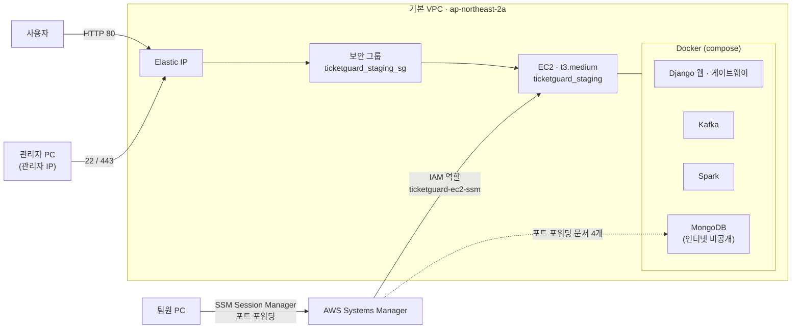

# TicketGuard · AWS 인프라 (Terraform)

콘솔에서 만든 스테이징 AWS 리소스를 Terraform으로 **import**하여 코드로 관리하는 구성.
기존 서버를 새로 만들지 않고 코드에 연결했으며, 연결 후 `terraform plan` 결과는 `No changes`.

- 작업 규칙: [`../AGENTS.md`](../AGENTS.md)
- 리전: `ap-northeast-2` (서울) · 관리 리소스 32개

## 아키텍처



- 보안 그룹 기준 공개 범위: 80은 전체, 22 · 443은 관리자 IP `/32` 한정, 그 외 포트는 모두 차단.
- MongoDB 포트는 보안 그룹에 열려 있지 않으며 SSM 포트 포워딩으로만 접근.
- 서버 안의 컨테이너 구성은 저장소의 `compose*.yml`이 담당하며 Terraform 관리 대상이 아님.

## 관리 대상

| 구분 | 리소스 | 코드 |
|---|---|---|
| 네트워크 | 보안 그룹 1 · 인바운드 규칙 3 · 아웃바운드 규칙 1 | `network.tf` |
| 서버 | EC2 인스턴스 · Elastic IP · EIP 연결 | `ec2.tf` |
| 서버 권한 | IAM 역할 · 인스턴스 프로파일 · SSM 정책 연결 | `iam_ec2.tf` |
| DB 접근 | SSM 포트 포워딩 문서 4개 | `ssm_documents.tf` |
| 팀원 권한 | 팀 관리형 정책 1 · 인라인 정책 8 · 연결 정책 8 | `iam_team.tf` |

### 코드에 넣지 않은 것

| 대상 | 이유 |
|---|---|
| 기본 VPC · 서브넷 · 팀원 IAM 사용자 | 읽기 전용 참조 (`data.tf`) |
| 키 페어 | 공개키 값 필요 · 이름 문자열만 사용 |
| 교육기관 관리 리소스 | 관리 권한 밖 |
| 비밀번호 · Access Key · 관리자 IP | 저장소 public · 로컬 파일(`terraform.tfvars`)에만 기록 |

## 보안 설계

| 항목 | 설계 | 위치 |
|---|---|---|
| DB 비공개 접근 | MongoDB 포트를 열지 않고 SSM Session Manager 포트 포워딩으로만 접근 | `ssm_documents.tf` |
| 접속 권한 범위 | 셸 · 포트 포워딩 권한을 서버 1대와 지정 문서 단위로 제한 · 본인 세션만 종료 가능 | `iam_team.tf` · `policies/` |
| 메타데이터 보호 | IMDSv2 필수 (`http_tokens = required`) | `ec2.tf` |
| 저장 데이터 암호화 | 루트 볼륨 암호화 | `ec2.tf` |
| 관리 포트 제한 | 22 · 443은 관리자 IP `/32` 한정 · 변수 검증으로 형식 강제 | `network.tf` · `variables.tf` |
| 삭제 방지 | 보안 그룹 · 서버 · 고정 IP에 `prevent_destroy` | `network.tf` · `ec2.tf` |
| 비밀 분리 | state · tfvars · plan 파일 `.gitignore` 제외 | 루트 `.gitignore` |

## 설계 결정

| 질문 | 결정과 이유 |
|---|---|
| 처음부터 코드로 만들지 않은 이유 | 콘솔로 먼저 구축해 운영 중이던 서버를 중단 없이 코드로 전환하기 위해 import 방식 선택. plan `No changes`로 코드와 실제 상태 일치를 검증 |
| state를 로컬에 두는 이유 | 작업자 1명 · S3 버킷 생성은 교육기관 계정 정책상 확인 필요. 전환 지점은 `backend.tf` 한 곳 |
| `imports.tf`를 남겨 둔 이유 | 어떤 리소스를 어떤 ID로 연결했는지 기록. 적용 후에는 동작하지 않으므로 유지해도 영향 없음 |
| `imports.tf`에 계정 ID가 있는 이유 | import ID는 실제 ARN이어야 함. 계정 ID는 비밀 정보가 아님 |
| IAM 사용자를 코드로 만들지 않은 이유 | 로그인 비밀번호 · Access Key가 state에 기록되는 것을 막기 위해 사용자는 읽기만 하고 정책만 관리 |
| 기본 VPC를 쓰는 이유 | 단일 스테이징 서버 구성 · 계정 기본 리소스를 변경하지 않기 위해 `data` 참조만 사용 |
| SSM 문서를 원문 그대로 쓰는 이유 | JSON을 정규화하면 AWS 저장 값과 글자가 달라져 문서 새 버전이 생김. 원문 파일을 가공 없이 사용 |
| `monitoring.tf` · `backup.tf`가 빈 이유 | 알람 · 백업 추가 시 파일 구조를 바꾸지 않기 위한 자리. 켜는 변수 기본값 `false` · 현재 리소스 없음 |

## 현재 한계와 후속 작업

| 항목 | 현재 | 후속 |
|---|---|---|
| 22번 포트 | 관리자 IP `/32` 한정 개방 (인스턴스 생성 시 설정) | SSM 접속으로 대체 완료 후 규칙 제거 |
| 80번 포트 | 전체 공개 | 서비스 공개 범위 재검토 |
| 팀원 조회 권한 | 접속 권한과 별도로 `AWSCloudShellFullAccess` · `IAMReadOnlyAccess` · `AmazonEC2ReadOnlyAccess` 연결 | 필요한 조회 동작만 담은 정책으로 축소 · 그룹 단위 관리로 통합 |
| SSM 문서 대상 | 문서 3개가 컨테이너 사설 IP를 고정값으로 사용 | 컨테이너 재생성 시 IP 변경 가능 · 고정 포트 방식으로 개선 |
| state 보관 | 작업 PC 로컬 | S3 backend + 잠금 |
| 운영 감시 · 백업 | 없음 | CloudWatch 알람 · S3 백업 |

## 파일 구성

| 파일 | 역할 |
|---|---|
| `versions.tf` · `backend.tf` · `provider.tf` | Terraform · provider 버전 · state 위치 · 리전 |
| `variables.tf` · `locals.tf` · `data.tf` | 입력 값 · 이름 규칙과 목록 · 읽기 전용 참조 |
| `network.tf` · `ec2.tf` | 보안 그룹 · 서버 · 고정 IP |
| `iam_ec2.tf` · `iam_team.tf` · `ssm_documents.tf` | 서버 권한 · 팀원 권한 · 포트 포워딩 문서 |
| `monitoring.tf` · `backup.tf` | 알람 · 백업 자리 (기본 꺼짐) |
| `imports.tf` · `outputs.tf` | import 이력 · 출력 값 (인스턴스 ID · 공인 IP · SSM 접속 명령) |
| `policies/` · `documents/` | AWS에서 내려받은 원문 JSON (가공 금지) |

## 사용법

필요 도구: Terraform 1.7 이상 · AWS CLI v2

```powershell
aws login
copy terraform.tfvars.example terraform.tfvars   # 관리자 IP 입력
terraform init
terraform plan
```

- 예상 결과: `No changes. Your infrastructure matches the configuration.`
- apply 전에 plan에 `must be replaced` · `destroy`가 없는지 확인
- 콘솔에서 직접 변경하지 않음 · 콘솔 변경은 다음 plan에 차이로 나타남
- 팀원 DB 접속 명령: `terraform output ssm_port_forward_commands`

### 원문 JSON 다시 내려받기

정책 · 문서를 콘솔에서 바꾼 경우 원문을 다시 받아 코드와 맞춤 (Git Bash 기준).

```bash
aws iam get-role --role-name ticketguard-ec2-ssm --query Role.AssumeRolePolicyDocument > policies/ec2_ssm_trust.json
aws iam get-user-policy --user-name ticketguard_Hong --policy-name TicketGuardShellAccess --query PolicyDocument > policies/TicketGuardShellAccess.json
aws ssm get-document --name TicketGuard-Mongo-PortForward --query Content --output text > documents/TicketGuard-Mongo-PortForward.json
```

- BOM 없는 UTF-8 · 끝 줄바꿈 1개로 저장 (PowerShell `>`는 BOM이 붙을 수 있음)

## 수정 방법

| 변경 | 수정 위치 |
|---|---|
| 팀원 추가 | `locals.tf`의 `team_users`에 이름 추가 |
| 포트 규칙 변경 | `network.tf`의 해당 규칙 |
| 포트 포워딩 문서 추가 | `locals.tf` 목록 + `documents/` 파일 |
| 알람 · 백업 켜기 | `terraform.tfvars`의 `enable_monitoring_alarms` · `enable_backup_bucket` |
| state를 S3로 이전 | `backend.tf` |
