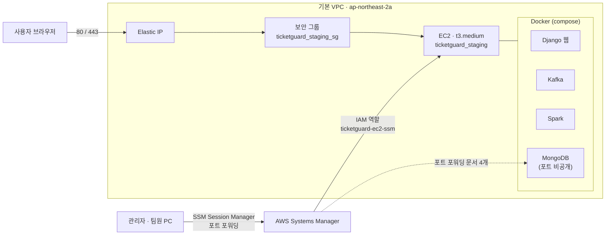

# TicketGuard · AWS 인프라 (Terraform)

콘솔에서 만든 스테이징 AWS 리소스를 Terraform으로 **import**하여 코드로 기록한 구성.
기존 서버를 새로 만들지 않고 코드에 연결했으며, 연결 후 `terraform plan` 결과는 `No changes`.

- 작업 규칙: [`../AGENTS.md`](../AGENTS.md)
- 작업 계획: [`../WORK_PLAN.md`](../WORK_PLAN.md)

## 아키텍처



- 서버 안의 컨테이너 구성은 저장소의 `compose*.yml`이 담당하며 Terraform 관리 대상이 아님.
- DB 포트는 인터넷에 공개하지 않고 SSM 포트 포워딩으로만 접근.

## 관리 대상

| 구분 | 리소스 | 코드 |
|---|---|---|
| 네트워크 | 보안 그룹 1 · 인바운드 규칙 3 · 아웃바운드 규칙 1 | `network.tf` |
| 서버 | EC2 인스턴스 · Elastic IP · EIP 연결 | `ec2.tf` |
| 서버 권한 | IAM 역할 · 인스턴스 프로파일 · SSM 정책 연결 | `iam_ec2.tf` |
| DB 접근 | SSM 포트 포워딩 문서 4개 | `ssm_documents.tf` |
| 팀원 권한 | 팀 관리형 정책 1 · 인라인 정책 8 · 연결 정책 8 | `iam_team.tf` |

합계 32개 리소스 · 코드에 연결한 시점의 계정 · 리전: `ap-northeast-2`.

### 코드에 넣지 않은 것

| 대상 | 이유 |
|---|---|
| 기본 VPC · 서브넷 · 팀원 IAM 사용자 | 읽기 전용 참조 (`data.tf`) |
| 키 페어 | 공개키 값 필요 · 이름 문자열만 사용 |
| 교육기관 관리 리소스 | 관리 권한 밖 |
| 비밀번호 · Access Key · 관리자 IP | 저장소 public · 로컬 파일(`terraform.tfvars`)에만 기록 |

## 보안 설계

| 항목 | 설계 | 위치 |
|---|---|---|
| SSH 없는 DB 접근 | SSM Session Manager 포트 포워딩 · MongoDB 포트 비공개 | `ssm_documents.tf` |
| 메타데이터 보호 | IMDSv2 필수 (`http_tokens = required`) | `ec2.tf` |
| 저장 데이터 암호화 | 루트 볼륨 암호화 | `ec2.tf` |
| 관리 포트 제한 | 22 · 443은 관리자 IP `/32` 한정 · 변수 검증으로 형식 강제 | `network.tf` · `variables.tf` |
| 최소 권한 | 팀원 권한을 문서 단위 인라인 정책과 조회 전용 정책으로 분리 | `iam_team.tf` |
| 삭제 방지 | 보안 그룹 · 서버 · 고정 IP에 `prevent_destroy` | `network.tf` · `ec2.tf` |
| 비밀 분리 | state · tfvars · plan 파일 `.gitignore` 제외 | 루트 `.gitignore` |

## 파일 구성

| 파일 | 역할 |
|---|---|
| `versions.tf` · `backend.tf` · `provider.tf` | Terraform · provider 버전 · state 위치 · 리전 |
| `variables.tf` · `locals.tf` · `data.tf` | 입력 값 · 이름 규칙과 목록 · 읽기 전용 참조 |
| `network.tf` · `ec2.tf` | 보안 그룹 · 서버 · 고정 IP |
| `iam_ec2.tf` · `iam_team.tf` · `ssm_documents.tf` | 서버 권한 · 팀원 권한 · 포트 포워딩 문서 |
| `monitoring.tf` · `backup.tf` | 알람 · 백업 (기본 꺼짐 · 리소스 없음) |
| `imports.tf` · `outputs.tf` | import 이력 · 출력 값 |
| `policies/` · `documents/` | AWS에서 내려받은 원문 JSON (가공 금지) |

## 사용법

```powershell
copy terraform.tfvars.example terraform.tfvars   # 관리자 IP 입력
terraform init
terraform plan
```

- 예상 결과: `No changes. Your infrastructure matches the configuration.`
- apply 전에 plan에 `must be replaced` · `destroy`가 없는지 확인
- 콘솔에서 직접 변경하지 않음 · 변경 후 코드에 반영하지 않으면 plan에 차이가 나타남

## 수정 방법

| 변경 | 수정 위치 |
|---|---|
| 팀원 추가 | `locals.tf`의 `team_users`에 이름 추가 후 `imports.tf` 확인 |
| 포트 규칙 변경 | `network.tf`의 해당 규칙 |
| 포트 포워딩 문서 추가 | `locals.tf` 목록 + `documents/` 파일 |
| 알람 · 백업 켜기 | `terraform.tfvars`의 `enable_monitoring_alarms` · `enable_backup_bucket` |
| state를 S3로 이전 | `backend.tf` |

## 한계와 후속 작업

- state는 작업 PC 로컬에 있으며 여러 PC에서 동시에 apply하지 않음 → S3 backend 전환 예정 (강사 확인 후).
- SSM 문서 3개는 컨테이너 사설 IP를 고정값으로 사용하므로 컨테이너 재생성 시 포트 포워딩이 끊길 수 있음.
- 22번 · 80번 포트 정책, 팀원 권한 그룹 통합, 공통 태그 도입은 현재 상태 기록 이후 별도 결정.
